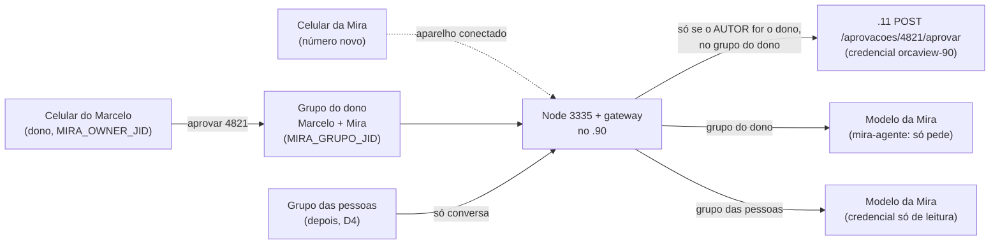
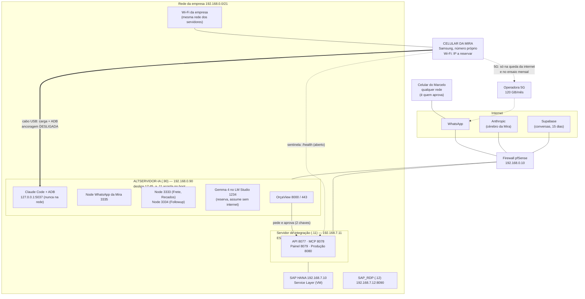

# Plano — Celular e número próprios para a Mira, com segurança

> **Status (19/11/2026): RASCUNHO, revisado contra o código.** O celular (Samsung, 8 GB, só para isso)
> ainda não chegou; nada foi mudado em lugar nenhum. Decisões D1–D6 fechadas em 18/11. Em 19/11 o
> repositório do web (`MarceloProjetos/web_orcaview`, pasta `web_orcaview_V118` no .90) foi lido no commit
> `1d52f22` e os 439 testes de WhatsApp/Mira rodaram numa cópia, todos verdes. O que essa leitura mudou
> está em "O que o código do web já tem". A F2 é código do web (não deste repo). **A .11 não muda** (só
> ganha, na vez do grupo das pessoas, uma credencial de leitura). Fechadas em 19/11: D7 (espelho local
> da memória no .90) e D8 (conversa 15 dias + resumo do dia aprovado, com prazo maior).

## O que muda

Hoje a 3ª instância do WhatsApp no .90 (porta 3335, `start-mira.js`) está pareada **na conta do Marcelo**,
em "modo grupo próprio": ele escreve num grupo em que só ele está, e o Node só repassa o que a própria
conta escreveu (`message_create` + `fromMe`). O cartão de aprovação sai da conta dele e volta como eco;
a 1ª trava é o anti-eco do Node, a 2ª é a mensagem inteira ter de ser o comando
(`docs/APROVACOES_11.md` § F5).

Depois: a Mira tem **número próprio**, num celular dedicado. O grupo passa a ter **dois membros**
(Marcelo + Mira). O Marcelo escreve do celular dele, e o `aprovar 4821` chega ao Node como **mensagem
recebida**, com o **autor** identificado. O eco deixa de existir: a Mira não recebe o que ela mesma envia.

## Mapa da rede

> Desenho para conversar: https://claude.ai/artifact/6swBTz7PooGZka7DTeFWKR (página privada do Marcelo; o
> mermaid abaixo é a cópia que fica no git).

Como imagino as peças. Os endereços vêm de `docs/PORTAS.md` do web e do `wake_altservidor_ia.py`; o IP
do celular no Wi-Fi ainda não existe (a reservar no pfSense). A rede da empresa é uma só,
`192.168.0.0/21` (de `192.168.0.0` a `192.168.7.255`), com saída por `192.168.0.10`.

Confirmado pelo Marcelo em 19/11: o Wi-Fi está **na mesma rede** dos servidores; a saída é um firewall
**pfSense** em `192.168.0.10`; a USB do .90 **carrega** com ele desligado.

Três caminhos saem do celular, e cada um tem uma função só:

| Caminho | Liga o celular a | Para quê | O que **não** passa |
|---|---|---|---|
| Cabo USB | o .90 | carregar (também com o .90 desligado); o Claude controlar (ADB); internet reserva **só quando a da empresa cai** | nada vai para a rede: o ADB escuta só em `127.0.0.1` |
| Wi-Fi da empresa | a rede `192.168.0.0/21` | WhatsApp do dia a dia; a sentinela olhar o `/health` da .11 e o .90 | nenhuma chave; só rotas abertas |
| 5G | a operadora | manter o WhatsApp e o SMS de alerta quando a internet ou a energia caem | a .11 nunca sai por ele |

## O que o código do web já tem (lido em 19/11)

Boa parte do que este plano pedia **já existe** no `web_orcaview`. O que muda fica bem menor.

| Assunto | Situação no código | O que sobra fazer |
|---|---|---|
| Cópia das conversas no Supabase, 15 dias (D2) | **Pronto.** `mira_conversas` com faxina de 15 dias feita pelo próprio app (`mira_persistencia.py`, `MIRA_CONVERSAS_RETENCAO_DIAS`); `mira_auditoria` fica para sempre | nada |
| Aprovar só o dono, por código, antes do modelo | **Pronto.** `_processar_um_turno` compara o **autor** com `MIRA_OWNER_JID`; quem não é o dono recebe "Só o dono da Mira aprova" | o Node passar a mandar o `author` (hoje não manda) |
| Quem não é o dono, no grupo | **Pronto.** `mira_identidade.do_whatsapp`: sem acesso a página nenhuma | credencial de leitura para o grupo das pessoas |
| `@lid` em vez do telefone | **Pronto** para o remetente (`resolverJidTelefone` no Node) | aplicar o mesmo ao `author` |
| Número próprio ("chip dedicado") | Foi o desenho original (F0/F1 do `PLANO_MIRA_WHATSAPP`) e foi abandonado; no Python virou constante (`MIRA_GRUPO_PROPRIO = True`) | modo novo no Node (F2) |
| Teto de mensagens e de gasto | **Pronto.** 15/min na rota; teto de gasto por dia | nada |
| Pausar a Mira | **Pronto** pela tela (pausa por agente e parada geral, `mira_agentes.py`) | conferir se existe por palavra no WhatsApp |
| Backup da sessão do WhatsApp | **Pronto.** `tools/ops/backup_sessoes.py` no boot, com `--restaurar` | nada; nunca sai do .90 |
| Vigia de fora do app | **Pronto.** `tools/vigia/vigia_orcaview.ps1`, a cada 12 min, avisa no grupo pelo Node da Mira | não cobre .90 desligado nem internet fora (a sentinela do celular cobre) |
| Aviso "servidor caído e ninguém olhando" | **Pronto.** `mira_queda_aviso.py` | idem |
| Relatório do dia no grupo | **Pronto.** `relatorio_dia.py`, antes do desligamento das 17:45 | incluir bateria e consumo do 5G |
| Modelo reserva sem internet | **Pronto.** Gemma 4 12B no LM Studio do .90 (`LLM_CHAT_MODEL`, `PLANO_RESERVA_GEMMA`): assume sozinho quando a Anthropic não responde (rede fora, sem crédito) | a memória dele sem internet (D7) |
| Memória organizada para busca ("RAG") | **Pronto**, no .90. `buscar_memoria` (`mira_memoria_busca.py`): busca por palavra e por sentido (modelo `bge-m3` na GPU do .90) na memória, nas conversas do WhatsApp do dono, no diário e nos manuais. Nada sai da empresa | o texto mora no Supabase: sem internet, não há o que buscar (D7) |
| Agentes com terminal livre no .90 (condição da D1) | Leitura rápida de `backend/services`: só comandos fixos (`ping`, `nvidia-smi`, `shutdown`, conversor de DWG). **Não é auditoria**: faltou olhar `kairos/` e `tools/` | fechar a conferência na F0 |

Quatro fatos do código que este plano não sabia:

1. **Parear é só por QR, em pessoa.** O pareamento por código de 8 dígitos não funciona na versão do
   WhatsApp Web que o projeto fixa (§ 3.1 do `PLANO_MIRA_WHATSAPP`). Alguém precisa apontar a câmera do
   celular da Mira para a tela. Depois disso, o `backup_sessoes.py --restaurar` evita QR novo.
2. **A API de grupos está quebrada nessa versão** (`getChats`/`getChatById` estouram). Conferir os membros
   do grupo por código provavelmente não dá; a defesa é o filtro por autor mais as travas do próprio grupo.
3. **O .90 desliga sozinho às 17:45** e a .11 o acorda no boot. A USB continua carregando o celular com
   ele desligado (confirmado em 19/11), então a noite e o fim de semana não descarregam o aparelho.
4. **O cérebro da Mira é a API da Anthropic**, na internet. Sem internet o WhatsApp para e o cérebro
   passa para o Gemma 4 do .90, que acerta menos. A internet reserva pelo 5G mantém os dois originais.

## Sem internet: o que continua funcionando

Pedido do Marcelo (19/11): se cair a internet **e** o 5G, o Gemma 4 assume. Ele já assume sozinho; o que
falta é ele ter do que se lembrar.

| Situação | WhatsApp da Mira | Quem responde | Memória |
|---|---|---|---|
| Tudo normal | funciona | Sonnet (Anthropic) | Supabase |
| Internet da empresa fora, 5G de pé | funciona, pela reserva do .90 | Sonnet | Supabase |
| Internet no ar, Anthropic fora ou sem crédito | funciona | **Gemma 4**, só texto, sem consultas | Supabase |
| **Internet e 5G fora** | **não funciona** (o WhatsApp precisa de internet) | **Gemma 4, só nas telas** do OrçaView, pela rede da empresa | **nenhuma hoje** (o texto mora no Supabase) |

O que isso quer dizer na última linha:

- Ninguém fala com a Mira pelo WhatsApp, nem aprova por lá. A aprovação continua pela Central da .11
  (`192.168.7.11:8077/inicio`), que é da rede local.
- O Gemma atende nas telas e consulta o SAP, que também é da rede local. Medido em 05/11: 35 certas em
  50 perguntas novas, 2 erradas (`PLANO_RESERVA_GEMMA`). Serve para consultar, com mais cuidado.
- Sem o Supabase, a Mira não lembra de conversa nenhuma nem dos fatos guardados.
- A sentinela avisa por **SMS**, que não usa dados: "internet e 5G fora; a Mira só nas telas, com o
  Gemma". Se a própria torre da operadora cair, nem o SMS sai.
- As mensagens mandadas no WhatsApp durante a queda: conferir no ensaio se o Node as recebe quando a
  conexão volta.

## A memória da Mira: onde fica

Pergunta do Marcelo (19/11): vale a pena o Supabase de 15 dias, ou é melhor usar a memória do WhatsApp do
aparelho, com um programa no celular que organize tudo como um RAG?

**Recomendação: a memória fica no .90, e o celular não entra nela.** Motivos:

- **O RAG já existe, no .90.** `buscar_memoria` procura por palavra e por sentido nas conversas, na
  memória aprovada, no diário e nos manuais, com o modelo de busca na GPU do .90.
- **Um programa não consegue ler o WhatsApp do aparelho.** As mensagens ficam num banco fechado dentro
  do app. Para ler seria preciso **root** (derruba a segurança do Android) ou ferramenta não oficial
  para abrir o backup. O Node do .90, ao contrário, já vê cada mensagem que entra e sai, em texto claro
  e organizada por quem falou e quando.
- **O celular fica longe de quem pergunta.** Quem usa a memória é a Mira, no .90. Para consultar o
  celular, um agente do .90 teria de alcançá-lo pelo ADB, justamente o que a D1 proíbe.
- **O celular é a peça mais fácil de perder.** Com a memória nele, um aparelho roubado leva tudo (regra 6).

**O que dá para criar, e que resolve o pedido do Gemma (D7): um espelho local da memória no .90.** Hoje
o texto mora só no Supabase. Um arquivo local no .90 (SQLite), atualizado a cada turno e com a mesma
regra de 15 dias, faz a busca funcionar sem internet, para o Sonnet e para o Gemma. O Supabase continua
sendo a cópia fora da máquina, que sobrevive a um disco perdido. Os vetores da busca já ficam no .90.

**D8 — por quanto tempo a Mira lembra.** Hoje é curto de propósito, por decisão do Marcelo: conversa 15
dias (24/08, eram 90); fato aprovado vale 7 dias, no máximo 30 fatos. Se a ideia agora é uma memória mais
longa e organizada, o caminho seguro é um **resumo do dia** (decisões e pendências, sem a conversa crua),
que o Marcelo aprova e que vale mais tempo. Aumentar o prazo da conversa crua também é possível, por
variável (`MIRA_CONVERSAS_RETENCAO_DIAS`), mas guarda mais dado pessoal.

## As regras que não mudam

1. **O celular da Mira nunca aprova.** Só o número do dono decide, tratado por código, antes do modelo.
   Quem pega o celular da Mira (ADB, scrcpy, Claude, um ladrão) alcança só o que a Mira já pode: **pedir**.
   Por isso a conta do Marcelo **nunca** entra nesse aparelho (nem WhatsApp, nem Google).
2. **A .11 fica como está:** as mesmas duas credenciais (`orcaview-90` decide, `mira-agente` só pede),
   `PROIBIDOS_AO_AGENTE`, interruptor e expediente. Nenhuma chave mora no celular.
3. **Controlar o celular à vontade é manutenção de uma pessoa presente**, nunca ação da Mira sozinha
   (regra do `acoes_agente.CATALOGO`). O que roda sozinho (vigia, internet reserva) é **script de
   comandos fixos**, escrito e revisado antes: nenhum modelo escolhe o comando.
4. **O celular fica fora do caminho da decisão e sem chave nenhuma.** Tudo que decide se uma mensagem é
   do dono (conexão do WhatsApp, transcrição do áudio, leitura do autor) roda no .90. Se o celular
   fizesse uma dessas coisas, bastaria mexer nele para forjar um "aprovar". O que ele fizer para aliviar
   o servidor (§ Ideias) só usa rotas abertas, como `/health`.
5. **Segurança acrescenta, nunca tira função:** o canal de aprovação pelo WhatsApp continua funcionando
   durante toda a troca, e voltar para a conta do Marcelo é o rollback (a sessão antiga fica guardada
   por 7 dias, F3).
6. **O celular é descartável.** A lista da F1 refaz um aparelho novo em 1 h. O que se perde com ele é só
   o histórico antigo da Mira: os últimos 15 dias estão no Supabase (D2), e a conversa com o dono também
   está no celular do dono.

## Ameaças e defesas

| Risco | Defesa |
|---|---|
| Celular roubado, perdido ou mexido por alguém | A conversa inteira fica no aparelho (D5), então o PIN e o apagar à distância são o que a protege. PIN de tela; verificação em duas etapas no WhatsApp (PIN + e-mail da empresa); "Encontrar meu celular" ligado (apagar à distância); PIN no chip. E a regra 1: o número da Mira não aprova nada. |
| Alguém lê a tela no escritório | Notificação **sem conteúdo** na tela bloqueada; tela apaga em 30 s. |
| ADB aberto para a rede | Só USB. **Depuração sem fio desligada**, nunca `adb tcpip`, nunca `adb -a` (o servidor adb fica em `127.0.0.1:5037`). Só o PC escolhido autorizado; "Revogar autorizações de depuração USB" a cada mudança. |
| Um agente do .90 (Mira, Téo) usa o ADB | O celular fica no .90 (D1), e qualquer processo de lá alcança o adb em `127.0.0.1:5037`. Quem invade o .90 já tem a chave que aprova (no `.env`), então o ADB não abre porta nova para ele. O risco real é um **modelo enganado** mandar mensagem como a Mira. Defesa: nenhum agente do .90 tem comando livre de terminal nem ferramenta de ADB; o MCP de Android só existe no Claude Code interativo; o que for automático usa comandos fixos (F5). |
| Estranho manda mensagem para o número da Mira (spam, injeção de prompt) | O Node só repassa o grupo do dono e, nele, só o autor dono (D4: no começo, só o Marcelo); os outros recebem **silêncio** (nem "não autorizado", que confirmaria que há um robô ali) e ficam no log. Privacidade do WhatsApp: "Quem pode me adicionar a grupos" = Meus contatos, com exceção de todos; "Silenciar chamadas de desconhecidos" ligado. |
| Um celular do grupo das pessoas é invadido ou alguém encaminha um texto armado | Esse grupo roda com uma credencial **só de leitura** (D4): nem pedir consegue. No grupo do dono, a chave de agente só **pede** e respeita interruptor e expediente; aprovar continua sendo do dono. |
| A franquia de 120 GB acaba no meio do mês (Windows Update ou nuvem baixando pela reserva) | No Windows do .90, a rede do celular marcada como **conexão limitada** (o Windows Update e os apps de nuvem param de baixar por ela). No Android, **aviso em 80 GB e limite em 110 GB**. O consumo do mês aparece no relatório do dia. O SMS da sentinela não gasta dados. |
| A reserva falha justo no dia em que precisa | **Ensaio mensal** automático: liga a ancoragem por 2 minutos, confere que a saída é a operadora, desliga, e o resultado sai no relatório do dia. |
| Internet reserva pelo 5G (Ideias, item 2) abre um caminho do .90 para fora do firewall | Ancoragem **desligada** por padrão; liga só quando a internet da empresa cai, por script de comandos fixos; adaptador como rede "Pública" no Windows (bloqueia entrada); a operadora já põe o celular atrás de NAT. |
| Alguém escreve "aprovar 4821" | Só decide a mensagem do **grupo do dono** cujo **autor** é o dono (já é assim no gateway). No grupo das pessoas, "aprovar 4821" é texto comum. Sem o `author` no payload, o autor vira o JID do grupo e a aprovação é **recusada** (falha fechada). |
| O WhatsApp identifica o dono como `…@lid`, não pelo telefone | O Node já traduz `@lid` para telefone no remetente (`resolverJidTelefone`); a F2 aplica o mesmo ao autor. Sem tradução, não aprova (falha fechada). Medir no ensaio: logar o autor cru da 1ª mensagem do dono. |
| Alguém rouba o **número do Marcelo** (troca de chip na operadora) e aprova no lugar dele | Verificação em duas etapas também no WhatsApp **do Marcelo**. E, se a biblioteca avisar que o código de segurança do dono mudou (aparelho novo), o gateway **suspende a aprovação pelo WhatsApp** até o Marcelo confirmar na Central; a tela continua aprovando. Conferir na F0 se o aviso existe. |
| Alguém entra no grupo do dono | O Node só repassa, desse grupo, mensagem cujo autor é o dono: um intruso fala e ninguém responde. Mas ele **lê** os cartões e relatórios. Por isso: grupo fixo pelo **ID**, só admin adiciona e muda o grupo, e o Marcelo é o único admin além da Mira. Conferir membros por código provavelmente não dá nesta versão do WhatsApp Web (API de grupos quebrada). |
| Arquivo, link ou áudio armado no grupo | No grupo, no começo, **só texto**: anexo e link não chegam ao modelo. Áudio só do dono. |
| Cópia das conversas no Supabase (D2) vaza ou fica para sempre | Já existe: `mira_conversas`, apagada pelo próprio app depois de 15 dias. Conferir que a tabela tem RLS ligado. A sessão do WhatsApp (credencial) **nunca** vai para o Supabase. |
| A sessão do WhatsApp Web no .90 vale a conta inteira | Pasta `.wwebjs_auth*` e os zips do `backup_sessoes.py` só para o usuário do serviço, fora do git, só no .90. Na troca, a sessão da conta do Marcelo fica 7 dias como rollback e depois é **apagada**, com os backups dela. |
| O celular fica sem bateria num fim de semana (o .90 desliga às 17:45) | Resolvido: a USB do .90 carrega com ele desligado (confirmado em 19/11). Com a proteção em 80 %, o aparelho pode ficar plugado direto. |
| O celular está **dentro** da rede dos servidores (o Wi-Fi é a mesma rede) | O pfSense não filtra conversa entre dois aparelhos da mesma rede, então não dá para "liberar o celular só para a .11 e o .90" por ele. O que protege: aparelho só com WhatsApp, atualizado, sem app extra, sem chave nenhuma, e as portas de escrita da .11 exigindo chave. Isolar de verdade pede um Wi-Fi separado (VLAN) com regra no pfSense: decisão para depois, se fizer falta. |

## Decisões

- **D1 — Onde o celular fica plugado. FECHADA (18/11): no .90** (`192.168.0.90`), que já tem o Claude
  Code. Condições: nenhum agente do .90 com terminal livre ou ADB (leitura rápida de 19/11: só comandos
  fixos; fechar na F0); o controle pelo Claude é em sessão interativa. O .90 desliga às 17:45, mas a USB
  segue carregando (confirmado em 19/11). **Nunca a .11.**
- **D2 — Backup das conversas da Mira. FECHADA (18/11): no Supabase, no máximo 15 dias. JÁ EXISTE.**
  A tabela `mira_conversas` guarda cada turno e o próprio app apaga o que passou de 15 dias (decisão do
  Marcelo de 24/08, `mira_persistencia.py`). A memória de longo prazo da Mira (`mira:*`) e a auditoria
  (`mira_auditoria`) são poupadas de propósito. O backup do próprio WhatsApp no Google Drive fica
  **desligado**. A decisão de cada aprovação continua na auditoria da .11.
- **D3 — Chip. FECHADA (18/11):** da empresa, linha privada, 5G. Falta: PIN no chip, um responsável
  pela linha (se o chip for perdido, é a operadora que bloqueia). Franquia: **120 GB/mês** (D6).
- **D4 — Quem a Mira atende no número novo. FECHADA (18/11):** **só o Marcelo** no começo; depois um
  **grupo privado** (até 6 números) com restrições próprias. Desenho recomendado: a restrição sai de
  **onde** a mensagem chegou, e cada lugar usa uma credencial da .11:

  | Onde | Credencial na .11 | Pode |
  |---|---|---|
  | Grupo do dono (Marcelo + Mira) | `mira-agente` (a de hoje) + decisão por código | conversar, pedir, **aprovar** |
  | Grupo das pessoas (outro grupo, depois) | **nova**, só `leitura` (`--agente`, declara usuário) | conversar e consultar; **não pede** escrita |

  O "privado" do Marcelo com a Mira é um **grupo de dois**, e não uma conversa direta, porque tudo que a
  Mira envia hoje (cartões, relatório do dia, alertas do vigia, temperaturas) vai para `MIRA_GRUPO_JID`.
  Mantendo um grupo, nada disso muda.

  Assim a restrição do grupo vale na .11, e não só no que o modelo "lembra" de não fazer. Cada número do
  grupo tem nome, para o gateway mandar `X-SIS-Usuario` = a pessoa. Abrir mais para alguém (pedir, ou
  aprovar como `pcp`) é decisão nova, um número por vez. A lista mora no `.env` do .90, **nunca no git**
  (telefone é dado pessoal).
- **D5 — Mensagens temporárias. FECHADA (18/11): não usar.** A conversa fica no celular e no WhatsApp.
  O limite de 15 dias vale só para a cópia do Supabase (D2).
- **D6 — Rede do celular. FECHADA (18/11): Wi-Fi da empresa e 5G, os dois ligados** (plano de
  **120 GB/mês**). Como usar cada um:

  | Via | Uso | Consumo |
  |---|---|---|
  | Wi-Fi da empresa | o dia a dia: WhatsApp, atualizações, e a sentinela enxergando a .11 e o .90 | não gasta a franquia |
  | 5G | o celular continua no ar quando a internet da empresa cai; internet reserva do .90; SMS de alerta | só na queda e no ensaio mensal |

  No Samsung, ligar "Alternar para dados móveis" (Wi-Fi → Wi-Fi inteligente): com o Wi-Fi conectado
  mas sem internet, o celular passa sozinho para o 5G. Atualização de sistema e de apps **só pelo
  Wi-Fi**. IP reservado no pfSense (mapeamento estático do DHCP), para o celular ter sempre o mesmo
  endereço e aparecer com nome nos registros. Como o Wi-Fi é a mesma rede dos servidores, o pfSense não
  limita o que o celular alcança lá dentro (§ Ameaças).
  A franquia sobra para o .90 sozinho; medir o consumo real dele na F0 para saber quantos dias de queda
  ela cobre.

- **D7 — Memória sem internet. FECHADA (19/11): fazer o espelho local no .90** (F6).
- **D8 — Por quanto tempo a Mira lembra. FECHADA (19/11):** a conversa continua em 15 dias, e nasce o
  **resumo do dia aprovado**, com prazo maior (F7).

## Fases

### F0 — Agora, antes do celular chegar
- ✔ Ler o gateway no web (19/11): resultado em "O que o código do web já tem".
- Fechar a conferência de que nenhum agente do .90 roda comando livre (falta `kairos/` e `tools/`).
- ✔ A USB do .90 carrega com a máquina desligada (confirmado em 19/11).
- Escolher o IP do celular e criar o mapeamento estático no pfSense.
- Medir quanto de internet o .90 gasta num dia normal (contador da placa de rede ou do roteador): é o
  número que diz quantos dias de queda os 120 GB cobrem.
- Conferir que `mira_conversas` tem RLS ligado no Supabase.
- **Ensaio sem internet** (fora do expediente, 10 minutos, cabo da internet fora e ancoragem desligada):
  o Gemma responde nas telas? consulta o SAP? o que a Mira diz sem memória? a Central da .11 aprova?
- Registrar na .11 a credencial só de leitura do grupo das pessoas (D4), quando chegar a vez dele.

### F1 — Preparar o celular (o Marcelo, à mão, ~1 h, ainda sem a Mira)
1. Atualizar o Android; PIN de tela; tela apaga em 30 s; notificações sem conteúdo na tela bloqueada.
2. Conta Google/Samsung **da empresa**; "Encontrar meu celular" ligado; nenhum app extra.
3. Chip com PIN (se o aparelho aceitar **eSIM**, melhor: ladrão não tira o chip); instalar o WhatsApp
   com o número novo; verificação em duas etapas com e-mail da empresa; **backup no Google Drive
   desligado** (D2).
4. Privacidade: grupos = Meus contatos (exceto todos), foto e "visto por último" só para contatos.
5. Bateria: Proteção da bateria = **Máxima** (80 %); WhatsApp em "Apps nunca suspensos" e "Sem restrição".
6. Wi-Fi fixo da empresa, IP reservado no roteador, "Alternar para dados móveis" ligado. Dados móveis:
   aviso em 80 GB, limite em 110 GB, ciclo no dia em que a franquia vira. Atualizações só pelo Wi-Fi.
7. Ainda **sem** depuração USB (só na F4) e com o **Bloqueador automático** do Samsung ligado.
8. **Aquecer o número:** foto e nome no perfil, e alguns dias de conversa normal, à mão, com o Marcelo,
   antes de ligar qualquer automação.
9. Ligar a verificação em duas etapas também no WhatsApp **do Marcelo** (o número que aprova).

### F2 — Modo "número próprio" (código no `web_orcaview`)
A mudança é quase toda no **Node**. O Python já decide pelo autor.

- `backend/start-mira.js`: modo novo por variável (ex.: `MIRA_NUMERO_PROPRIO=true`). Nele o serviço
  **não** entra no modo grupo próprio (que escuta `message_create` + `fromMe`): escuta `message`, com o
  grupo do dono e o dono como recorte. Sem a variável, tudo fica como hoje (é o rollback).
- `backend/whatsapp_node_service.js`, em `repassarInbound`, no modo novo:
  - aceitar só mensagem cujo chat é o grupo do dono **e** cujo autor (traduzido de `@lid`) é o dono;
  - mandar `author` no payload (hoje não vai; a rota já lê `dados.get("author")`);
  - descartar `fromMe` (defesa a mais: no evento `message` ele nem chega).
- `backend/routes/mira_whatsapp_routes.py`: nada obrigatório (o recorte "o grupo é `MIRA_GRUPO_JID`" já
  serve); acrescentar a recusa de `fromMe` no modo novo.
- `backend/services/mira_whatsapp_gateway.py`: nada (a comparação `autor != dono` já existe).
- **Modo ensaio** (como o `GRAVA_A_PARTIR_DE` do worker): recebe, registra no log o que decidiria e
  **não chama a .11**. Roda alguns dias com o número novo antes da troca.
- Depois, o grupo das pessoas (D4): um segundo JID (ex.: `MIRA_GRUPO_PESSOAS_JID`), só texto, com a
  credencial de leitura escolhida pela **origem** da mensagem, nunca pelo texto.
- Efeito colateral: o grupo novo tem outro ID, então a Mira não reencontra os últimos 15 dias de
  conversa do grupo antigo. A memória de longo prazo (`mira:*`) não é afetada.
- Testes novos (os 439 de hoje continuam valendo):
  - outra pessoa manda `aprovar <código real>` no grupo do dono → o Node nem repassa;
  - o dono manda `aprovar 4821` no grupo do dono → decide uma vez, com `canal: "whatsapp"`;
  - payload sem `author` → "Só o dono da Mira aprova" (falha fechada);
  - autor em `@lid` sem tradução → não decide;
  - `fromMe` no modo novo → descartado;
  - sem `MIRA_NUMERO_PROPRIO` → comportamento de hoje, byte a byte;
  - (grupo das pessoas) pedido de escrita → a .11 recusa; `aprovar 4821` → nada decide.

### F3 — A troca no ar (fora do expediente, com o Marcelo no .90)
0. Antes: alguns dias de **modo ensaio**, lendo o log (o autor do dono chegou em que formato? o que
   teria sido decidido?).
1. `backup_sessoes.py` da sessão atual (a conta do Marcelo) e guardar o zip: é o rollback por 7 dias.
2. `tools/session/reset_whatsapp_mira.bat`, ligar o modo novo, e ler o **QR** com o celular da Mira, em
   pessoa (o código de 8 dígitos não funciona nesta versão). O QR dura ~20 s; o cão de guarda renova.
3. Criar o grupo de dois (Marcelo + Mira), só admins adicionam; descobrir o ID (comando `/mira` dentro
   dele ou o log) e pôr em `MIRA_GRUPO_JID`.
4. Conferir, nesta ordem: outra pessoa manda `aprovar <código real>` → nada; o Marcelo manda
   `aprovar 0000` → `404 nao_encontrado` no log; um pedido real de baixo risco (`forcar_carga`) aprovado
   pelo Marcelo → executa; outro recusado → recusa; o relatório do dia e um alerta do vigia chegam no
   grupo novo.
5. Depois de 7 dias sem precisar voltar: no celular do Marcelo, Aparelhos conectados → desconectar o
   .90, e apagar o zip e a pasta da sessão antiga.
6. Anotar a data no topo deste plano e uma linha no § F5 do `docs/APROVACOES_11.md`.

### F4 — Claude controla o celular (no .90, D1)
0. No Samsung recente, a Depuração USB só liga com o **Bloqueador automático** desligado (ele também
   barra app de fora da loja, como o Termux). Desligar é perder uma proteção: conferir no aparelho e
   decidir na hora se o controle pelo Claude vale isso.
1. Instalar Android Platform Tools (adb) e scrcpy; ligar Modo desenvolvedor → **Depuração USB**; USB em
   "Somente carregamento"; aceitar a chave **só do .90**. Depuração sem fio desligada.
2. MCP de Android no Claude Code do .90, que **já está instalado** (18/11). Candidato:
   `mobile-next/mobile-mcp`; conferir nome e versão no README antes de instalar.
3. Permissões do Claude Code: leitura (print, lista de apps, bateria) pode ser liberada; tocar, digitar,
   instalar e abrir app **perguntam sempre**.
4. Uso: diagnóstico e conferir se o WhatsApp está de pé. Refazer o pareamento **não** dá por aqui (é QR,
   com a câmera): para isso existe o `backup_sessoes.py --restaurar`. **Não** é para mandar as mensagens
   da Mira pela tela: isso continua sendo o Node.

### F5 — Opcional, depois: saber se está vivo
O que importa é a **sessão do Node 3335 estar conectada** (o celular só precisa entrar na internet a cada
14 dias). O vigia de fora do app já olha isso a cada 12 minutos. Se um dia o celular também for vigiado,
por comandos fixos de leitura (bateria, Wi-Fi), nunca toque nem texto.

### F6 — Espelho local da memória no .90 (código no `web_orcaview`, D7)
Não depende do celular: pode ser feito antes de ele chegar.

Toda leitura e escrita da memória da Mira passa por um arquivo só, `backend/services/mira_persistencia.py`
(tabela `mira_conversas`: conversa, fatos aprovados `mira:memoria`, propostas, jornal). O espelho entra aí.

- **Arquivo local:** um SQLite no .90 (WAL), fora do git, com as mesmas colunas da tabela.
- **Escrita:** cada turno vai para o Supabase **e** para o espelho. Se o Supabase não responder, a linha
  fica marcada como pendente no espelho e sobe quando a internet voltar.
- **Leitura:** Supabase primeiro, como hoje. Só quando ele não responde, a leitura vem do espelho
  (`carregar_historico`, `buscar_conversas`, `memoria_listar`). **Com internet, nada muda.**
- **Encher e conferir:** no boot e na rotina horária, o espelho puxa do Supabase o que falta dos últimos
  15 dias.
- **Esquecer vale nos dois:** a faxina de 15 dias (que poupa `mira:*`) e o `esquecer` de um fato apagam
  também no espelho. Sem isso o espelho viraria a memória que nunca esquece.
- **A auditoria não é espelhada.** `mira_auditoria` é gravada antes de cada ação ("sem registro, sem
  ação"). Sem internet o registro não grava, então a Mira **só consulta, não age**. É o comportamento
  certo para o Gemma sozinho, e fica como está.
- **Proteção do arquivo:** tem o texto das conversas. Pasta só para o usuário do serviço, fora dos
  backups que saem da máquina.
- Testes: escrita dupla; Supabase fora → lê do espelho; pendente sobe uma vez só (sem duplicar);
  faxina e `esquecer` apagam nos dois; com Supabase no ar, a resposta é idêntica à de hoje.
- Conferência final: o **ensaio sem internet** da F0, agora esperando que a Mira lembre.

### F7 — Resumo do dia aprovado (código no `web_orcaview`, D8)
A conversa crua continua saindo em 15 dias. O que fica por mais tempo é um resumo curto, que o Marcelo
aprova.

- **Quando:** junto do relatório do dia, antes do desligamento das 17:45 (`relatorio_dia.py`).
- **O que tem:** decisões tomadas, pendências e combinados do dia, em poucas linhas. Sem a conversa
  crua, sem telefone, sem dado pessoal que não precise estar lá.
- **Aprovação:** o resumo é só uma **proposta** até o Marcelo responder `CONFIRMAR <código>`, o mesmo
  caminho que a ferramenta `lembrar` já usa (o modelo propõe, o código grava depois do sim). Sem
  resposta, o resumo não é guardado.
- **Onde fica:** em `mira_conversas`, num chat próprio (`mira:resumos`), poupado da faxina de 15 dias
  como os outros `mira:*`, e no espelho local (F6).
- **Como é usado:** entra na busca de memória (`buscar_memoria`) como mais uma fonte, só para o dono.
- Recomendações a confirmar antes de codar: **prazo de 90 dias** por resumo; o Marcelo pode corrigir o
  texto antes de confirmar; `esquecer resumo de <data>` apaga um.

## Ideias para depois: o celular ajudando o servidor

Por ordem de valor. Nenhuma está decidida.

1. **Sentinela independente (a melhor).** O web já tem vigia (a cada 12 min) e o aviso de servidor
   caído, mas os dois avisam **pelo WhatsApp da Mira, que roda no .90**: com o .90 desligado ou a
   internet fora, ninguém é avisado. O celular tem **5G e bateria próprios**. Com Termux (versão do
   F-Droid/GitHub; a da Play Store é velha), um script de poucas linhas confere a cada minuto e avisa
   o dono por **SMS** (`termux-sms-send`, oficial; funciona sem internet e sem WhatsApp). Não guarda
   chave nenhuma (regra 4). O que ele consegue distinguir:

   | O que o celular vê | O que aconteceu |
   |---|---|
   | Wi-Fi conectado, sem internet | caiu a internet da empresa |
   | Wi-Fi sumiu **e** parou de carregar | faltou energia (ele avisa a hora da queda e a da volta) |
   | Parou de carregar, Wi-Fi normal | o cabo soltou, ou faltou energia só no .90 (a USB carrega mesmo com ele desligado, então "desligou" não explica) |
   | `/health` da .11 não responde, resto normal | a API da .11 caiu |
   | .90 não responde, carregando | o .90 está desligado (normal depois das 17:45) ou travou (em horário de trabalho, é alerta) |

   **Horários de silêncio**, senão vira SMS toda noite: o .90 desligado das 17:45 até a .11 acordá-lo;
   a .11 reiniciando por volta das 06:12; a .12 dormindo à noite; fins de semana e feriados.
2. **Internet reserva para o .90 pelo 5G (ancoragem USB).** Vale mais do que parecia: o cérebro da Mira
   é a API da Anthropic, então sem internet ela fica sem WhatsApp **e** cai para o Gemma, que acerta menos. O Windows não troca sozinho
   quando a internet cai mas a rede local fica de pé: a placa de rede continua "conectada". Por isso,
   um script no .90 confere a internet a cada minuto; se ela cair (rede local de pé), liga a ancoragem
   por ADB (comando fixo) e a usa só para a saída; quando voltar, desliga. A rede local
   (`192.168.0.0/21`, onde estão a .11 e o SAP) segue pela placa de rede. Cuidados:
   - **Testar antes de confiar:** a ancoragem repassa a rede que o celular estiver usando. Com o Wi-Fi
     conectado e sem internet, ele deve repassar o 5G, mas isso se confere tirando o cabo da internet
     do roteador por 5 minutos (fora do expediente).
   - Rede do celular como **conexão limitada** no Windows; ensaio mensal (§ Ameaças).
   - Socorre **só o .90**: nunca transformar o .90 em roteador da empresa, e a .11 **não** sai por
     ele (a máquina que escreve no SAP não ganha um caminho novo para a internet). Sem internet, as
     cargas da .11 para o Supabase esperam e retomam sozinhas.
   - Ancoragem e carga juntas esquentam o aparelho.
   - Para a empresa inteira, o caminho é o próprio **pfSense**: ele aceita uma segunda saída (um modem
     ou roteador 5G com chip próprio) e troca sozinho quando a principal cai (grupo de gateways). Aí
     todos os servidores ganham reserva sem script nenhum, e o celular da Mira fica só para o WhatsApp.
     Vale orçar: é mais simples e mais seguro que a ancoragem pelo .90.
3. **Segundo despertador do .90.** O `wake_altservidor_ia.py` só usa biblioteca padrão e Python 3.8+:
   roda no Termux sem mudança. Se a sentinela vir o .90 desligado em horário de trabalho, manda o
   magic packet pelo Wi-Fi da empresa, sem depender da .11 ter reiniciado.
4. **Bateria e 5G no relatório do dia.** O relatório que a Mira já manda antes das 17:45 ganha uma
   linha: "celular: bateria 78 %, 5G: 3 de 120 GB, último ensaio da reserva: ok". Um bom-dia curto de
   manhã ("tudo de pé") é o complemento: o valor está na **falta** dele.
5. **A .11 vigia o WhatsApp da Mira.** A ronda que a .11 já faz no .90 (`operacao/ronda_90.py`) passa a
   ler também "o Node 3335 está conectado?", e isso aparece na Central.
6. **Os outros dois números.** O .90 tem mais duas contas de WhatsApp (3333 Frete/Recados, 3334
   Followup), cada uma presa a um celular que também precisa aparecer na internet a cada 14 dias. Se
   algum desses chips vive num aparelho pessoal, o mesmo celular dedicado (ou um irmão dele) resolve.
7. **Não recomendado:**
   - Trocar a biblioteca do WhatsApp para aliviar o .90. São três Chromes (cerca de 400 MB cada), mas o
     projeto depende de uma versão fixada do WhatsApp Web, com vários contornos que custaram caro
     (§ 3.1 do `PLANO_MIRA_WHATSAPP`). Trocar é reabrir tudo isso. Antes de qualquer coisa, **medir**.
   - Levar para o celular a conexão do WhatsApp, a transcrição do áudio ou um modelo pequeno. As duas
     primeiras quebram a regra 4; o modelo no aparelho de 8 GB é fraco e economiza pouco.

Requisito de qualquer item que rode no celular: Bloqueador automático desligado (F4, passo 0), Termux em
"Apps nunca suspensos" e `termux-wake-lock`, senão o Samsung fecha o script.

## Se der errado

- **Algo estranho no celular:** no próprio aparelho, Aparelhos conectados → desconectar tudo; revogar as
  autorizações de depuração USB.
- **Celular perdido:** "Encontrar meu celular" → apagar; a operadora bloqueia o chip; registrar o número
  em outro aparelho derruba todas as sessões. Na .11 não há nada a fazer: o número da Mira não aprova.
- **Problema no modo novo (até 7 dias depois da troca):** tirar `MIRA_NUMERO_PROPRIO`, voltar o
  `MIRA_GRUPO_JID` antigo e `backup_sessoes.py --restaurar` com o zip da conta do Marcelo: volta o
  funcionamento de hoje sem QR. Depois de 7 dias, o rollback é ler o QR com o número do Marcelo.

## Onde mora o quê

- Este plano fica aqui porque o canal de aprovação é contrato deste repo (`docs/APROVACOES_11.md`).
- Código da F2: repositório `MarceloProjetos/web_orcaview` (pasta `web_orcaview_V118` no .90):
  `backend/start-mira.js`, `backend/whatsapp_node_service.js`, `backend/routes/mira_whatsapp_routes.py`,
  `backend/services/mira_whatsapp_gateway.py`, `mira_aprovacoes.py`; guia `docs/agent/whatsapp.md`;
  limites da versão fixada em `docs/PLANO_MIRA_WHATSAPP.md` § 3.1.
- F1, F3 e F4 são do Marcelo, à mão.
