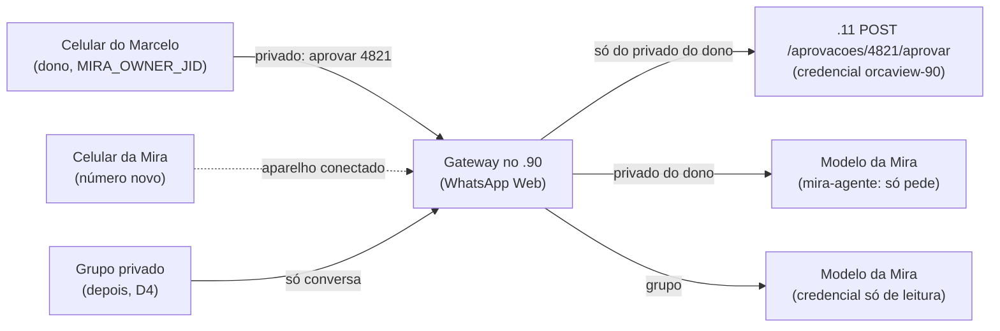

# Plano — Celular e número próprios para a Mira, com segurança

> **Status (18/11/2026): RASCUNHO.** O celular (Samsung, 8 GB, só para isso) ainda não chegou; nada foi
> mudado em lugar nenhum. Fechadas em 18/11: D1 (**plugado no .90**), D3 (chip da empresa, linha privada,
> 5G), D4 (**só o Marcelo** no começo; depois um grupo privado com restrições próprias), D2 (cópia das
> conversas no **Supabase, no máximo 15 dias**), D5 (a conversa **fica** no celular e no WhatsApp) e D6
> (**Wi-Fi da empresa + 5G de 120 GB/mês**). Nenhuma aberta. A F2 é código do `web_orcaview_V118`
> (não deste repo). **A .11 não muda** (só ganha, na vez do grupo, uma credencial de leitura).

## O que muda

Hoje o gateway do WhatsApp da Mira (`mira_whatsapp_gateway.py`, no .90) está logado **na conta do
Marcelo**: o cartão de aprovação sai da conta dele e volta pelo `message_create`; a 1ª trava é o anti-eco
do Node, a 2ª é a mensagem inteira ter de ser o comando (`docs/APROVACOES_11.md` § F5).

Depois: a Mira tem **número próprio**, num celular dedicado. O Marcelo aprova **do celular dele**, e o
`aprovar 4821` passa a chegar ao gateway como **mensagem recebida de outro número**.

## As regras que não mudam

1. **O celular da Mira nunca aprova.** Só o número do dono decide, tratado por código, antes do modelo.
   Quem pega o celular da Mira (ADB, scrcpy, Claude, um ladrão) alcança só o que a Mira já pode: **pedir**.
   Por isso a conta do Marcelo **nunca** entra nesse aparelho (nem WhatsApp, nem Google).
2. **A .11 fica como está:** as mesmas duas credenciais (`orcaview-90` decide, `mira-agente` só pede),
   `PROIBIDOS_AO_AGENTE`, interruptor e expediente. Nenhuma chave mora no celular.
3. **Controlar o celular à vontade é manutenção de uma pessoa presente**, nunca ação da Mira sozinha
   (regra do `acoes_agente.CATALOGO`). O que roda sozinho (vigia, internet reserva) é **script de
   comandos fixos**, escrito e revisado antes: nenhum modelo escolhe o comando.
4. **O celular fica fora do caminho da decisão e sem chave nenhuma.** Tudo que decide se uma mensagem é
   do dono (conexão do WhatsApp, transcrição do áudio, leitura do autor) roda no .90. Se o celular
   fizesse uma dessas coisas, bastaria mexer nele para forjar um "aprovar". O que ele fizer para aliviar
   o servidor (§ Ideias) só usa rotas abertas, como `/health`.
5. **Segurança acrescenta, nunca tira função:** o canal de aprovação pelo WhatsApp continua funcionando
   durante toda a troca, e voltar para a conta do Marcelo é o rollback.
6. **O celular é descartável.** A lista da F1 refaz um aparelho novo em 1 h. O que se perde com ele é só
   o histórico antigo da Mira: os últimos 15 dias estão no Supabase (D2), e a conversa com o dono também
   está no celular do dono.

## Ameaças e defesas

| Risco | Defesa |
|---|---|
| Celular roubado, perdido ou mexido por alguém | A conversa inteira fica no aparelho (D5), então o PIN e o apagar à distância são o que a protege. PIN de tela; verificação em duas etapas no WhatsApp (PIN + e-mail da empresa); "Encontrar meu celular" ligado (apagar à distância); PIN no chip. E a regra 1: o número da Mira não aprova nada. |
| Alguém lê a tela no escritório | Notificação **sem conteúdo** na tela bloqueada; tela apaga em 30 s. |
| ADB aberto para a rede | Só USB. **Depuração sem fio desligada**, nunca `adb tcpip`, nunca `adb -a` (o servidor adb fica em `127.0.0.1:5037`). Só o PC escolhido autorizado; "Revogar autorizações de depuração USB" a cada mudança. |
| Um agente do .90 (Mira, Téo) usa o ADB | O celular fica no .90 (D1), e qualquer processo de lá alcança o adb em `127.0.0.1:5037`. Quem invade o .90 já tem a chave que aprova (no `.env`), então o ADB não abre porta nova para ele. O risco real é um **modelo enganado** mandar mensagem como a Mira. Defesa: nenhum agente do .90 tem comando livre de terminal nem ferramenta de ADB; o MCP de Android só existe no Claude Code interativo; o que for automático usa comandos fixos (F5). |
| Estranho manda mensagem para o número da Mira (spam, injeção de prompt) | O gateway só atende a **lista** (D4: no começo, só o Marcelo); os outros recebem **silêncio** (nem "não autorizado", que confirmaria que há um robô ali) e ficam no log. Privacidade do WhatsApp: "Quem pode me adicionar a grupos" = Meus contatos, com exceção de todos; "Silenciar chamadas de desconhecidos" ligado. |
| Um celular do grupo é invadido ou alguém encaminha um texto armado | O grupo roda com uma credencial **só de leitura** (D4): nem pedir consegue. No privado do dono, a chave de agente só **pede** e respeita interruptor e expediente; aprovar continua sendo do dono. |
| A franquia de 120 GB acaba no meio do mês (Windows Update ou nuvem baixando pela reserva) | No Windows do .90, a rede do celular marcada como **conexão limitada** (o Windows Update e os apps de nuvem param de baixar por ela). No Android, **aviso em 80 GB e limite em 110 GB**. O consumo do mês aparece no bom-dia. O SMS da sentinela não gasta dados. |
| A reserva falha justo no dia em que precisa | **Ensaio mensal** automático: liga a ancoragem por 2 minutos, confere que a saída é a operadora, desliga, e o resultado sai no bom-dia. |
| Internet reserva pelo 5G (Ideias, item 2) abre um caminho do .90 para fora do firewall | Ancoragem **desligada** por padrão; liga só quando a internet da empresa cai, por script de comandos fixos; adaptador como rede "Pública" no Windows (bloqueia entrada); a operadora já põe o celular atrás de NAT. |
| Alguém escreve "aprovar 4821" no grupo | **Aprovação só vale no privado do dono.** No grupo, "aprovar 4821" é texto comum, de quem for. Cartões de aprovação também só vão para o privado. Testes na F2. |
| O WhatsApp identifica o dono como `…@lid`, não pelo telefone | A comparação falha **fechada** (não aprova). Medir no 1º dia: logar o remetente cru da 1ª mensagem do dono e aceitar os dois formatos do dono, por configuração. |
| Alguém rouba o **número do Marcelo** (troca de chip na operadora) e aprova no lugar dele | Verificação em duas etapas também no WhatsApp **do Marcelo**. E, se a biblioteca avisar que o código de segurança do dono mudou (aparelho novo), o gateway **suspende a aprovação pelo WhatsApp** até o Marcelo confirmar na Central; a tela continua aprovando. Conferir na F0 se o aviso existe. |
| Alguém entra no grupo sem estar na lista | O grupo é fixo pelo **ID** (não pelo nome). A cada mensagem o gateway confere os membros: com um estranho dentro, a Mira se cala no grupo e avisa o dono no privado. No WhatsApp: só admin adiciona e muda o grupo. |
| Arquivo, link ou áudio armado no grupo | No grupo, no começo, **só texto**: anexo e link não chegam ao modelo. Áudio só do dono. |
| Cópia das conversas no Supabase (D2) vaza ou fica para sempre | Tabela com RLS ligado e **sem política** (só a chave de serviço do .90 lê e grava); guarda o **nome** da pessoa, não o telefone; faxina diária apaga o que passou de 15 dias. A sessão do WhatsApp (credencial) **nunca** vai para o Supabase. |
| A sessão do WhatsApp Web no .90 vale a conta inteira | Pasta da sessão e backups do `subir_stack_boot.ps1` só para o usuário do serviço, fora do git. Na troca, **apagar** a sessão e os backups da conta do Marcelo. |
| Número bloqueado pelo WhatsApp (automação não oficial) | Número novo que já nasce automatizado é o que mais cai: **aquecer** antes (F1, uso normal à mão por alguns dias). Volume baixo, poucos contatos. Plano B: voltar à conta do Marcelo; mais adiante, a API oficial. |
| Claude erra no celular pelo MCP | Só em sessão interativa com o Marcelo vendo. Ferramentas de leitura (print, bateria) liberadas; **tocar, digitar e abrir app sempre pedem confirmação** (nunca "permitir tudo" nesse MCP). |
| Conta Google ou Samsung pessoal no aparelho | Conta dedicada da empresa; nenhum app além do necessário. |

## Decisões

- **D1 — Onde o celular fica plugado. FECHADA (18/11): no .90.** Condições: nenhum agente do .90 com
  terminal livre ou ADB (confirmar na F0 o que Mira e Téo podem rodar); o Claude Code que controla o
  celular roda no .90 (ou por Remote Control até ele), em sessão interativa. Com o .90 desligado a USB
  pode não carregar: a bateria segura até o Wake-on-LAN. **Nunca a .11.**
- **D2 — Backup das conversas da Mira. FECHADA (18/11): no Supabase, no máximo 15 dias.** O backup do
  próprio WhatsApp só vai para o Google Drive, então ele fica **desligado**. Quem copia é o gateway no
  .90: cada mensagem que entra ou sai (texto ou transcrição, nome de quem falou, onde, quando) vai para
  uma tabela do Supabase, e uma faxina diária apaga o que passou de 15 dias. Sem anexos nem áudio no
  começo. Os backups internos do Supabase ainda seguram os dados alguns dias além disso, conforme o plano
  contratado. A decisão de cada aprovação continua na auditoria da .11, que não depende dessa cópia.
- **D3 — Chip. FECHADA (18/11):** da empresa, linha privada, 5G. Falta: PIN no chip, um responsável
  pela linha (se o chip for perdido, é a operadora que bloqueia). Franquia: **120 GB/mês** (D6).
- **D4 — Quem a Mira atende no número novo. FECHADA (18/11):** **só o Marcelo** no começo; depois um
  **grupo privado** (até 6 números) com restrições próprias. Desenho recomendado: a restrição sai de
  **onde** a mensagem chegou, e cada lugar usa uma credencial da .11:

  | Onde | Credencial na .11 | Pode |
  |---|---|---|
  | Privado do Marcelo | `mira-agente` (a de hoje) + decisão por código | conversar, pedir, **aprovar** |
  | Grupo privado | **nova**, só `leitura` (`--agente`, declara usuário) | conversar e consultar; **não pede** escrita |

  Assim a restrição do grupo vale na .11, e não só no que o modelo "lembra" de não fazer. Cada número do
  grupo tem nome, para o gateway mandar `X-SIS-Usuario` = a pessoa. Abrir mais para alguém (pedir, ou
  aprovar como `pcp`) é decisão nova, um número por vez. A lista mora no `.env` do .90, **nunca no git**
  (telefone é dado pessoal).
- **D5 — Mensagens temporárias. FECHADA (18/11): não usar.** A conversa fica no celular e no WhatsApp.
  O limite de 15 dias vale só para a cópia do Supabase (D2).
- **D6 — Rede do celular. FECHADA (18/11): Wi-Fi da empresa e 5G, os dois ligados** (plano de
  **120 GB/mês**). Como usar cada um:

  | Via | Uso | Consumo |
  |---|---|---|
  | Wi-Fi da empresa | o dia a dia: WhatsApp, atualizações, e a sentinela enxergando a .11 e o .90 | não gasta a franquia |
  | 5G | o celular continua no ar quando a internet da empresa cai; internet reserva do .90; SMS de alerta | só na queda e no ensaio mensal |

  No Samsung, ligar "Alternar para dados móveis" (Wi-Fi → Wi-Fi inteligente): com o Wi-Fi conectado
  mas sem internet, o celular passa sozinho para o 5G. Atualização de sistema e de apps **só pelo
  Wi-Fi**. IP reservado no roteador e, se ele permitir, o celular liberado só para a `.11:8077` e o .90.
  A franquia sobra para o .90 sozinho; medir o consumo real dele na F0 para saber quantos dias de queda
  ela cobre.

## Fases

### F0 — Agora, antes do celular chegar
- Medir quanto de internet o .90 gasta num dia normal (contador da placa de rede ou do roteador): é o
  número que diz quantos dias de queda os 120 GB cobrem.
- Confirmar que nenhum agente do .90 (Mira, Téo) roda comando livre de terminal (condição da D1).
- Registrar na .11 a credencial só de leitura do grupo (D4), quando chegar a vez do grupo.
- Ler o gateway no `web_orcaview_V118` e anotar aqui: onde está o anti-eco, onde está a comparação com
  `MIRA_OWNER_JID`, onde mora a pasta da sessão e o backup dela. Precisa daquele repo na sessão.

### F1 — Preparar o celular (o Marcelo, à mão, ~1 h, ainda sem a Mira)
1. Atualizar o Android; PIN de tela; tela apaga em 30 s; notificações sem conteúdo na tela bloqueada.
2. Conta Google/Samsung **da empresa**; "Encontrar meu celular" ligado; nenhum app extra.
3. Chip com PIN (se o aparelho aceitar **eSIM**, melhor: ladrão não tira o chip); instalar o WhatsApp
   com o número novo; verificação em duas etapas com e-mail da empresa; **backup no Google Drive
   desligado** (D2).
4. Privacidade: grupos = Meus contatos (exceto todos), foto e "visto por último" só para contatos.
5. Bateria: Proteção da bateria = **Máxima** (80 %); WhatsApp em "Apps nunca suspensos" e "Sem restrição".
6. Wi-Fi fixo da empresa, IP reservado no roteador, "Alternar para dados móveis" ligado. Dados móveis:
   aviso em 80 GB, limite em 110 GB, ciclo no dia em que a franquia vira. Atualizações só pelo Wi-Fi.
7. Ainda **sem** depuração USB (só na F4) e com o **Bloqueador automático** do Samsung ligado.
8. **Aquecer o número:** foto e nome no perfil, e alguns dias de conversa normal, à mão, com o Marcelo,
   antes de ligar qualquer automação.
9. Ligar a verificação em duas etapas também no WhatsApp **do Marcelo** (o número que aprova).

### F2 — Gateway com número próprio (código no `web_orcaview_V118`)
- Modo novo por configuração (ex.: `MIRA_MODO_NUMERO=proprio` × `conta_do_dono`), o atual continua
  existindo: rollback = trocar a variável e ler o QR com o número do Marcelo.
- No modo próprio: decisão só de mensagem **recebida no privado do dono** (telefone ou `@lid`,
  configurados); no grupo nada decide; tudo que a Mira envia é ignorado. Cartões só no privado do dono.
- **Modo ensaio** (como o `GRAVA_A_PARTIR_DE` do worker): o gateway recebe, registra no log o que
  decidiria e **não chama a .11**. Roda alguns dias com o número novo antes da troca.
- **Pausa por palavra:** `pausar` e `retomar`, só do dono, tratadas por código antes do modelo. Pausada,
  a Mira não responde a ninguém.
- Cópia das conversas no Supabase com faxina de 15 dias (D2); guarda do grupo (ID fixo, membros
  conferidos, só texto).
- Lista de números (D4: número → nome, onde fala); o resto é ignorado e registrado no log, sem resposta.
- A credencial é escolhida pela **origem** da mensagem (privado do dono × grupo), nunca pelo texto.
- Testes obrigatórios:
  - outro número manda `aprovar <código real>` → nada decide;
  - a própria Mira posta o cartão (com as linhas "aprovar 4821") → nada decide;
  - o dono manda `aprovar 4821` no privado → decide uma vez, com `canal: "whatsapp"`;
  - o dono manda `aprovar 4821` **no grupo** → nada decide;
  - grupo com um membro fora da lista → a Mira não responde no grupo e avisa o dono;
  - pedido de escrita vindo do grupo → a .11 recusa (credencial só de leitura);
  - linha com mais de 15 dias → a faxina apaga;
  - mensagem de número fora da lista → não chega ao modelo;
  - `author` em formato desconhecido → não decide (falha fechada).

### F3 — A troca no ar (fora do expediente)
0. Antes: alguns dias de **modo ensaio** com o número novo, lendo o log (o remetente do dono chegou em
   que formato? o que teria sido decidido?).
1. No celular do Marcelo: Aparelhos conectados → **desconectar** a sessão do .90. Apagar a pasta da
   sessão e os backups dela no .90.
2. Ligar o modo novo, ler o QR com o celular da Mira (ou "Conectar com número de telefone").
3. Conversar só no privado Marcelo ↔ Mira. O grupo fica para depois (D4).
4. Conferir, nesta ordem: outra pessoa manda `aprovar <código real>` → nada; o Marcelo manda
   `aprovar 0000` → `404 nao_encontrado` no log; um pedido real de baixo risco (`forcar_carga`) aprovado
   pelo Marcelo → executa; outro recusado → recusa.
5. Anotar a data no topo deste plano e uma linha no § F5 do `docs/APROVACOES_11.md`.

### F4 — Claude controla o celular (no .90, D1)
0. No Samsung recente, a Depuração USB só liga com o **Bloqueador automático** desligado (ele também
   barra app de fora da loja, como o Termux). Desligar é perder uma proteção: conferir no aparelho e
   decidir na hora se o controle pelo Claude vale isso.
1. Instalar Android Platform Tools (adb) e scrcpy; ligar Modo desenvolvedor → **Depuração USB**; USB em
   "Somente carregamento"; aceitar a chave **só desse PC**. Depuração sem fio desligada.
2. MCP de Android no Claude Code do .90, que **já está instalado** (18/11) (candidato: `mobile-next/mobile-mcp`; conferir nome e versão
   no README antes de instalar).
3. Permissões do Claude Code: leitura (print, lista de apps, bateria) pode ser liberada; tocar, digitar,
   instalar e abrir app **perguntam sempre**.
4. Uso: diagnóstico, conferir se o WhatsApp está de pé, refazer a conexão do .90 pelo código de
   telefone. **Não** é para mandar as mensagens da Mira pela tela: isso continua sendo o gateway.

### F5 — Opcional, depois: saber se está vivo
O que importa é a **sessão do gateway estar conectada** (o celular só precisa entrar na internet a cada
14 dias). Vigiar o estado do gateway no .90 vale mais que vigiar o aparelho. Se um dia o celular também
for vigiado, por comandos fixos de leitura (bateria, Wi-Fi), nunca toque nem texto.

## Ideias para depois: o celular ajudando o servidor

Por ordem de valor. Nenhuma está decidida.

1. **Sentinela independente (a melhor).** Hoje, se o .90 cai, a Mira cai junto e ninguém é avisado. O
   celular tem **5G e bateria próprios**: é o único aparelho que continua vivo quando falta internet ou
   energia. Com Termux (versão do F-Droid/GitHub; a da Play Store é velha), um script de poucas linhas
   confere a cada minuto e avisa o dono por **SMS** (`termux-sms-send`, oficial; funciona sem internet e
   sem WhatsApp). Não guarda chave nenhuma (regra 4). O que ele consegue distinguir:

   | O que o celular vê | O que aconteceu |
   |---|---|
   | Wi-Fi conectado, sem internet | caiu a internet da empresa |
   | Wi-Fi sumiu **e** parou de carregar | faltou energia (ele avisa a hora da queda e a da volta) |
   | Parou de carregar, Wi-Fi normal | o .90 desligou ou o cabo soltou |
   | `/health` da .11 não responde, resto normal | a API da .11 caiu |
   | .90 não responde, carregando | o OrcaView travou no .90 |
2. **Internet reserva para o .90 pelo 5G (ancoragem USB).** O Windows não troca sozinho quando a
   internet cai mas a rede local fica de pé: a placa de rede continua "conectada" e o tráfego segue por
   ela. Por isso, um script no .90 confere a internet a cada minuto; se ela cair (rede local de pé),
   liga a ancoragem por ADB (comando fixo) e a usa só para a saída; quando voltar, desliga. A rota para
   a .11 (`192.168.7.x`) segue pela rede local. Ganho: a Mira continua no WhatsApp e avisa os outros
   durante a queda. Cuidados:
   - **Testar antes de confiar:** a ancoragem repassa a rede que o celular estiver usando. Com o Wi-Fi
     conectado e sem internet, ele deve repassar o 5G, mas isso se confere tirando o cabo da internet
     do roteador por 5 minutos (fora do expediente).
   - Rede do celular como **conexão limitada** no Windows; ensaio mensal (§ Ameaças).
   - Socorre **só o .90**: nunca transformar o .90 em roteador da empresa, e a .11 **não** sai por
     ele (a máquina que escreve no SAP não ganha um caminho novo para a internet). Sem internet, as
     cargas da .11 para o Supabase esperam e retomam sozinhas.
   - Ancoragem e carga juntas esquentam o aparelho.
   - Para a empresa inteira, o certo é um roteador com segunda saída 5G e chip próprio.
3. **Segundo despertador do .90.** O `wake_altservidor_ia.py` só usa biblioteca padrão e Python 3.8+:
   roda no Termux sem mudança. Se a sentinela vir o .90 desligado em horário de trabalho, manda o
   magic packet pelo Wi-Fi da empresa, sem depender da .11 ter reiniciado.
4. **Aliviar o .90 sem o celular.** O `whatsapp-web.js` mantém um Chromium inteiro aberto (centenas de
   MB de RAM). Bibliotecas que falam direto com o WhatsApp, como Baileys, não precisam de navegador.
   Antes de decidir, **medir** o que pesa no .90 (Chromium, Node, modelo).
5. **Bom-dia da Mira.** Todo dia útil, às 7 h, uma mensagem curta ao dono: ".11 e .90 de pé, WhatsApp
   conectado, bateria 78 %, 5G: 3 de 120 GB, último ensaio da reserva: ok". O valor está na **falta** dela: se não chegou, algo parou, mesmo que nenhum
   alarme tenha tocado.
6. **A .11 vigia o gateway.** A ronda que a .11 já faz no .90 (`operacao/ronda_90.py`) passa a ler também
   "o WhatsApp da Mira está conectado?", e isso aparece na Central.
7. **Não recomendado:** levar para o celular a conexão do WhatsApp, a transcrição do áudio ou um modelo
   pequeno para triagem. As duas primeiras quebram a regra 4. O modelo no aparelho de 8 GB é fraco e
   economiza pouco.

Requisito de qualquer item que rode no celular: Bloqueador automático desligado (F4, passo 0), Termux em
"Apps nunca suspensos" e `termux-wake-lock`,
senão o Samsung fecha o script.

## Se der errado

- **Algo estranho no celular:** no próprio aparelho, Aparelhos conectados → desconectar tudo; revogar as
  autorizações de depuração USB.
- **Celular perdido:** "Encontrar meu celular" → apagar; a operadora bloqueia o chip; registrar o número
  em outro aparelho derruba todas as sessões. Na .11 não há nada a fazer: o número da Mira não aprova.
- **Gateway com problema no modo novo:** voltar a variável para `conta_do_dono` e ler o QR com o número
  do Marcelo (o funcionamento de hoje).

## Onde mora o quê

- Este plano fica aqui porque o canal de aprovação é contrato deste repo (`docs/APROVACOES_11.md`).
- Código da F2: `web_orcaview_V118` (`mira_whatsapp_gateway.py`, `mira_aprovacoes.py`,
  `docs/agent/whatsapp.md`).
- F1, F3 e F4 são do Marcelo, à mão.
