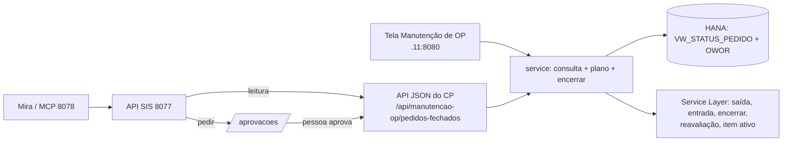

# PLANO — Encerrar OPs de pedidos fechados (Manutenção de OP)

> **Status (28/10/2026):** plano escrito, **aguardando aprovação**. Nada implementado.
> Hoje isto roda à mão na .11 com dois scripts de `maintenance/` (`encerrar_ops_pedidos_fechados.py`
> e `ajustar_e_encerrar_ops.py`). O plano os transforma em função da tela, da API e da Mira.

**Começo → Meio → Fim:** a regra que já funciona nos scripts vira função do CP → a tela da
Manutenção de OP lista os pedidos e encerra só os marcados → a API e a Mira consultam e
**pedem** o encerramento, que uma pessoa aprova.

## Números de hoje (PROD, 28/10/2026, consulta só de leitura)

| O quê | Valor |
| --- | --- |
| Pedidos fechados com `Atrasado = 'N'` e OP aberta | **10 pedidos / 140 OPs** |
| Pedidos fechados com `Atrasado = 'S'` | 135 (fora do filtro pedido) |
| Tempo medido por OP (saída + entrada + encerrar) | ~2 s (log da .11, 28/10) |
| OPs já encerradas hoje pelos scripts | ~2,8 mil (72 pedidos + 6 ajustados) |

## Fatos que travam o desenho

1. **Gravação no SAP só sai da .11** (`PRODUCTION_MACHINE_IP`). Fora dela, a tela e a API respondem 503.
2. **"Encerrar" = saída de insumo + entrada do produto + encerrar** (`service.finalizar_ops`), filha antes
   da mãe. É o único jeito de encerrar que o CP tem; o plano reusa, não cria outro.
3. **Uma execução por módulo** (`core.tarefas.TAREFAS`): enquanto encerra, a Manutenção de OP fica ocupada,
   e o `deploy_update.bat` espera.
4. **Agente nunca grava nem aprova.** A Mira só **pede** (`POST /aprovacoes` + `acoes_agente.CATALOGO`);
   uma pessoa aprova na Central da .11 ou com "aprovar <código>".
5. **Três falhas já vistas no lote de 28/10**, todas com tratamento conhecido:
   - `10001287 Item cost not found`: matéria-prima com custo zero. Grava custo (reavaliação de estoque)
     e tenta o pedido de novo.
   - `10001069 Item ... inactive`: insumo inativo no cadastro. Só passa reativando o item durante o
     encerramento e inativando de novo no fim.
   - `Server disconnected`: o Service Layer caiu. Basta tentar de novo.
6. **Semiacabado não recebe o custo padrão.** O item que uma OP filha do mesmo
   pedido produz ganha custo real quando a filha encerra. No lote, sem essa exclusão, seriam 60 pedidos
   reavaliados em vez de 5.
7. **Não alterar o que já existe na página** (Marcelo, 28/10). A busca por pedido, liberar, replanejar,
   "Encerrar todas as OPs de um pedido" e "Cancelar as OPs de um pedido", assim como as rotas e a API delas,
   continuam iguais. O card novo só **reaproveita** essas peças sem mudá-las: `service.finalizar_ops`,
   `levanta_ops`, a ordem filha → mãe, a página Sim/Não (`confirmar.html` + token de uso único), as Execuções
   com Interromper e o `/execucoes/{id}` da API. Os testes atuais da Manutenção de OP têm de passar sem
   nenhuma mudança neles: esse é o sinal de que nada existente foi tocado.
8. **Valor com vírgula no PowerShell virou 0,1.** Na tela e na API o campo é numérico;
   aceita "0,01" e "0.01" porque não passa por shell.

## Arquitetura

## Fases

### F0 — Regra comum no CP
**Goal:** a consulta e o encerramento com ajustes existem como funções do CP, testadas, sem tela ainda.

- `queries.py`: `PEDIDOS_FECHADOS_COM_OP` = a SQL pedida (`StatusPedido = 'Fechado' AND Atrasado = 'N'`) +
  contagem real de OPs Planejadas/Liberadas no `OWOR`. Também traz cliente e data de entrega, que estão na view.
  Pedido com 0 OP aberta não entra.
- `service.py`: `pedidos_fechados_com_op()`, `insumos_sem_custo(pedido)` (exclui semiacabado),
  `reavalia_custo(sl, insumos, valor)` e `ativa_itens(...)`/`restaura_itens(...)`. Isso sai dos dois scripts
  de `maintenance/`, que passam a chamar o service.
- Execução por pedido: `finalizar_ops`. Se falhar com `10001287`, reavalia e tenta o pedido uma vez. Se
  falhar com `Server disconnected`, tenta uma vez. Se falhar com `10001069`, só reativa quando a opção
  estiver marcada (D3).
- Testes em `tests/controleproducao/` com SL e HANA falsos: semiacabado fora do custo, item volta a inativo
  mesmo com erro, uma única retentativa, valor vazio = 0,01.

### F1 — Tela "Pedidos fechados com OPs abertas"
**Goal:** na Manutenção de OP, o PCP consulta, marca os pedidos e encerra só os marcados, com Sim/Não.

- **Card separado** na `manutencao_op.html` (pedido do Marcelo, 28/10), com título, consulta, lista e
  botão próprios. Não mistura com a busca por pedido nem com a grade de OPs que já existem:
  - botão **Consultar pedidos fechados com OPs abertas**;
  - tabela com **checkbox por pedido** + "Selecionar todos", e as colunas Pedido, Cliente, Entrega,
    OPs abertas e Planejadas;
  - no fim da página: campo **"Custo para insumo sem custo (opcional)"**, vazio = 0,01, e o botão
    **Encerrar selecionados**.
- "Encerrar selecionados" abre a conferência com os pedidos, o total de OPs, a ordem e o custo que será
  usado. A confirmação é a página **Sim / Não** que já existe (`confirmar.html`, token de uso único).
- Roda como Execução em segundo plano, com **Interromper** entre OPs (nunca no meio de uma). O resultado
  sai por pedido: encerradas, puladas, com erro e reavaliações gravadas.
- Pedido não marcado nunca entra. O plano guarda os números marcados, e a execução não relê a lista.
- Conferência visual no .90, claro e escuro, só desktop.

### F2 — API JSON do CP
**Goal:** qualquer sistema com a chave consulta a lista e encerra pedidos escolhidos pela API.

- `GET /api/manutencao-op/pedidos-fechados` → lista (mesma da tela).
- `POST /api/manutencao-op/pedidos-fechados/encerrar/conferir` `{pedidos: [..], custo?: 0.01, ativar_inativos?: false}`
  → plano + `token`.
- `POST /api/manutencao-op/pedidos-fechados/encerrar/executar` `{token, solicitante}` → 202 + execução.
  O acompanhamento é o `GET /execucoes/{id}` que já existe.
- Contrato em `API_MANUTENCAO_OP.md`, no mesmo commit.

### F3 — SIS 8077 + MCP
**Goal:** a Mira (e qualquer cliente MCP) lê a lista e pede o encerramento; uma pessoa aprova.

- SIS: `GET /controle-producao/pedidos-fechados-com-op` (escopo `leitura`), que lê do CP por loopback.
- MCP: `pedidos_fechados_com_op()` (leitura) e `pedir_encerrar_ops_pedidos_fechados(pedidos, custo, motivo)`
  (pedido de aprovação).
- `acoes_agente.CATALOGO`: ação `encerrar_ops_pedidos_fechados`. Aprova **PCP ou admin**. A prévia vem do
  `conferir`. Na execução, o CP confere de novo: se o plano mudou (pedido saiu da lista, OPs diferentes),
  recusa e pede outra aprovação, como o `processar_pedido` já faz.
- `ESCOPO_DA_FERRAMENTA` e `PEDIDOS` do `acesso_mcp.py` com as duas tools.

### F4 — Mira (repo web_orcaview_V118)
**Goal:** a Mira responde "quais pedidos fechados têm OP aberta?" e encaminha o pedido de encerramento.

- `mira_agentes.py` (LEITURA e PEDE), `mira_aprovacoes.py` (mapa da ação), `mira_agente.py` (rótulos) e
  `mira_habilidades.py`, com os testes que já listam as tools `pedir_*`.

### F5 — Uso real
**Goal:** os 10 pedidos de hoje (140 OPs) encerrados pela tela, conferidos no SAP.

- Primeiro 1 pedido pela tela, depois os outros 9. Depois disso, um pedido via Mira com aprovação.

## Decisões

1. **Filtro `Atrasado = 'N'`.** A SQL pedida deixa de fora 135 pedidos fechados com `Atrasado = 'S'`.
   Recomendo: `N` como padrão + caixa "incluir atrasados" na tela e `incluir_atrasados` na API.
2. **Um campo de custo para a seleção inteira**, aplicado só às matérias-primas com custo zero dos pedidos
   marcados. Vazio = 0,01. Recomendo: sim, um campo só.
3. **Item inativo:** reativar sozinho ou falhar? Recomendo: caixa opcional "ativar itens
   inativos só durante o encerramento", desmarcada por padrão. Sem ela, o pedido sai como falha, com o item
   nomeado.
4. **Quem aprova o pedido da Mira:** Recomendo: PCP ou admin, como "processar pedido".
5. **Tamanho do pedido da Mira:** Recomendo: até 20 pedidos por aprovação e 5 pedidos de
   aprovação por hora. Na tela, sem limite.
6. **Os scripts de `maintenance/`:** Recomendo: manter, chamando o service (reserva para
   rodar sem a tela).

---
Fonte: este arquivo. Página: artifact publicado com o mesmo conteúdo. Origem: lote manual de 28/10/2026
(commits 4517951, a33f6a8, a887c49, 7490939).
