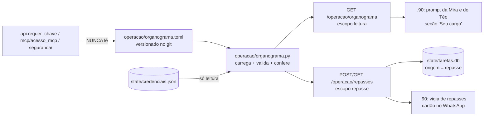

# PLANO — Organograma do escritório (Mira, Téo e as pessoas)

> **Status (02/11/2026):** proposta, **aguardando aprovação do Marcelo**. Nada no código ainda.
> **D2 decidida** (Marcelo, 02/11): Felipe e Gabriel substituem o diretor. As outras decisões (fim do
> arquivo) precisam de resposta antes da F1; a F0 é ele quem preenche.

**Começo → Meio → Fim:** cada agente e cada pessoa ganha uma ficha por escrito (cargo, o que faz, o
que não faz, a quem escala) → a .11 lê, confere com as credenciais e entrega a ficha às agentes →
uma pergunta que chega à agente errada vira um **repasse** para a dona do assunto, sem a pessoa
repetir, e volta para uma pessoa se ninguém resolver.

## A regra inegociável

> **O cargo nunca dá permissão.** A ficha decide **para quem vai** e **como a agente se apresenta**.
> Quem decide **o que pode rodar** continua sendo o que já existe: escopos da credencial
> (`seguranca/credenciais.py`), `PROIBIDOS_AO_AGENTE`, `acoes_agente.CATALOGO` + `pode_aprovar`,
> o interruptor e o horário (`seguranca/agente.py`).

Consequências que o plano trava em código e teste:

1. **Nenhum caminho de autorização lê o organograma.** `seguranca/`, `mcp/acesso_mcp.py` e o
   `requer_chave` do `api.py` não importam `operacao.organograma` (teste por AST, F1).
2. **Ficha que promete mais do que a credencial dá = vale a credencial.** A conferência (F1) aponta a
   diferença; ninguém ganha escopo por estar na ficha.
3. **Ficha que promete menos do que a credencial dá = só aviso.** "Segurança acrescenta, nunca tira
   função": a conferência **nunca revoga** nada. Tirar escopo é decisão do Marcelo, à mão, com
   `python -m seguranca`.
4. **Quem aprova não sai da ficha.** O papel de quem decide (`X-SIS-Papel`, `PAPEIS_PCP`,
   `PAPEIS_ADMIN`) continua vindo de onde vem hoje. A ficha só **descreve** quem aprova o quê, para a
   agente saber a quem pedir.

## Fatos que travam o desenho

1. **As agentes moram no .90** (repo `web_orcaview_V118`: `mira_whatsapp_gateway.py`, prompts,
   WhatsApp). Este repo não vê os prompts. O plano tem **duas frentes**: .11 (este repo: ficha,
   conferência, API, repasse) e .90 (prompts e roteamento na conversa).
2. **Só a .11 vê todas as credenciais e todos os pedidos** — é por isso que as aprovações moram aqui.
   Pelo mesmo motivo a ficha mora aqui: é o único lugar onde dá para conferir ficha × credencial.
3. **O repo é público.** A ficha leva cargo, papel e primeiro nome — **nunca** telefone, JID do
   WhatsApp, e-mail ou sobrenome. O contato de cada pessoa continua no `.env` do .90
   (`MIRA_OWNER_JID` e afins), referenciado na ficha por um apelido (`contato = "dono"`).
4. **Escrita de agente só seg–sex 07–19h** (`seguranca/agente.py`). Um repasse é escrita (na base da
   .11, nunca no SAP), então segue a regra (D5).
5. **Já existe o padrão de "um dono por alvo"**: `aprovacoes.criar` em `BEGIN IMMEDIATE`, índice
   parcial `(acao, alvo)` nos estados abertos, `Idempotency-Key`, teto por hora, varredura de órfãos.
   O repasse **copia o padrão** num arquivo próprio; o `aprovacoes.db` não é tocado.
6. **Sem `pip`**: a ficha é TOML, lida com `tomllib` (stdlib desde o 3.11; a .11 roda 3.14).

## Organograma proposto (para o Marcelo corrigir na F0)

| Quem | Tipo | Cargo | Cuida de | Não faz | Escala para |
| --- | --- | --- | --- | --- | --- |
| **Marcelo** | pessoa | Diretor | Aprova o crítico (`admin`); dono de todo tema sem dono | — | Felipe, Gabriel (D2) |
| **Felipe** | pessoa | Substituto do diretor (D2) | Aprova o crítico quando o Marcelo não está | — | Marcelo |
| **Gabriel** | pessoa | Substituto do diretor (D2) | Aprova o crítico quando o Marcelo não está | — | Marcelo |
| **Mira** | agente | Atendimento, Comercial e PCP | Cliente, orçamento, pedido, entrega, OS, OP (consulta); **pede** processar pedido, encerrar OPs de fechados, forçar carga | Servidor, rede, SAP fora do ar, backup, reinício; nunca aprova; nunca muda data de entrega | Equipe PCP (OP/pedido), Comercial (cliente), Marcelo |
| **Téo** | agente | TI | Serviços da .11, SAP ServerTools, conexões, backup, Hyper-V, Windows Update, logins SAP; **pede** reinício de serviço e do SAP | Pedido, cliente, OP; nunca aprova | Marcelo |
| **Equipe PCP** | pessoas (papel `pcp`) | PCP | Aprova `processar_pedido` e `encerrar_ops_pedidos_fechados` | — | Marcelo |
| **Comercial** | pessoas | Comercial | Pede mudança da data combinada (`entrega:solicitar`) | — | Marcelo |
| **Produção** | pessoas | Produção | Decide as solicitações de data | — | PCP / Marcelo |
| **Anderson** | pessoa | SAP / addon (a confirmar) | `controleproducao/`, addon C# | — | Marcelo |

**Uma divergência que a conferência já vai mostrar no 1º dia:** a credencial `mira-agente` tem
`servico:reiniciar` (SEGURANCA_11.md, F5), mas pelo cargo reiniciar serviço é da TI (Téo). A F1
**só aponta**; manter ou tirar é do Marcelo (D8). Isso é a regra 3 funcionando, não um defeito.

### Temas (o roteamento)

Cada pergunta cai num tema; cada tema tem **um** dono e um substituto. Tema desconhecido = Marcelo.

| Tema | Dono | Substituto | Exemplo de pergunta |
| --- | --- | --- | --- |
| `atendimento` | Mira | Comercial | "o cliente X ligou cobrando" |
| `orcamento` | Mira | Comercial | "o orçamento 1234 virou pedido?" |
| `pedido` | Mira | PCP | "em que pé está o pedido 84000?" |
| `entrega` | Mira | Produção | "dá para antecipar a entrega?" |
| `op` | Mira | PCP | "as OPs do pedido foram liberadas?" |
| `ti_servidor` | Téo | Marcelo | "a Central está fora", "o SAP caiu" |
| `ti_acesso` | Téo | Marcelo | "não consigo logar no SAP" |
| `ti_backup` | Téo | Marcelo | "o backup rodou?" |
| `aprovacao_critica` | Marcelo | Felipe, Gabriel | pedido com papel `admin` |
| `outro` | Marcelo | Felipe, Gabriel | o que não casou com nenhum |

## Arquitetura



## Fases

### F0 — A ficha por escrito (Marcelo; ~meio dia; nenhum código)

**Goal:** `operacao/organograma.toml` existe, revisado pelo Marcelo, com as decisões D1–D8 tomadas.

Formato (exemplo; os comentários do arquivo explicam cada campo):

```toml
versao = 1

[[membro]]
id = "mira"
tipo = "agente"
credencial = "mira-agente"          # o nome em state/credenciais.json
cargo = "Atendimento, Comercial e PCP"
cuida_de = ["atendimento", "orcamento", "pedido", "entrega", "op"]
pede = ["processar_pedido", "encerrar_ops_pedidos_fechados", "forcar_carga"]   # chaves do CATALOGO
escopos_esperados = ["leitura", "oportunidades:carga", "pedidos_wbc", "manutencao_op", "repasse"]
nao_faz = ["aprovar", "reiniciar servidor", "mudar data de entrega"]
escala_para = ["pcp", "comercial", "marcelo"]
apresentacao = "Sou a Mira, do atendimento e do PCP."

[[membro]]
id = "marcelo"
tipo = "pessoa"
cargo = "Diretor"
aprova = ["admin"]                  # descreve; quem confere o papel é o X-SIS-Papel, não isto
contato = "dono"                    # apelido; o JID mora no .env do .90 (repo público)
substitutos = ["felipe", "gabriel"] # D2 (02/11/2026)

[[tema]]
id = "ti_servidor"
dono = "teo"
substituto = "marcelo"
descricao = "serviços da .11, SAP fora do ar, conexões"
exemplos = ["a Central está fora", "o SAP caiu"]
```

### F1 — Leitor, validação e conferência (.11; ~1 dia)

**Goal:** `operacao/organograma.py` carrega a ficha, recusa ficha inconsistente e compara com as
credenciais **sem escrever nada**.

- `carregar()` com `tomllib`; cache por `mtime` (editar o arquivo e dar `git pull` basta, sem restart).
- `validar()` — erro de carga, e a .11 segue com a **última ficha válida** (nunca "sem cargo"):
  - todo `tema.dono`, `substituto` e `escala_para` aponta para um `membro.id` existente;
  - toda cadeia de escalada termina numa **pessoa** e não tem ciclo;
  - todo item de `pede` existe no `acoes_agente.CATALOGO`;
  - todo `escopos_esperados` existe em `ESCOPOS`; agente nunca lista `PROIBIDOS_AO_AGENTE`;
  - nenhum campo com cara de telefone/e-mail/JID (regex; o repo é público);
  - existe o tema `outro`.
- `conferir()` — lê `credenciais.carregar()` (só leitura) e devolve, por agente:
  `faltam` (ficha espera, credencial não tem — a ação falharia), `sobram` (credencial tem, cargo não
  prevê — aviso, nunca revoga), `sem_credencial`, `credencial_sem_ficha`.
- CLI: `python -m operacao.organograma` (tabela) e `... conferir` (sai 1 se houver `faltam`).
- Testes `tests/test_organograma.py`:
  - ficha do repo é válida (o teste quebra se alguém editar errado — é o gate);
  - cada regra do `validar()` com uma ficha quebrada;
  - **a regra inegociável**: ficha dizendo que a Mira tem `admin` → `requer_chave` continua 403;
  - **por AST**: `seguranca/*.py`, `mcp/acesso_mcp.py` e o `requer_chave` não importam nem referenciam
    `organograma`;
  - `conferir()` nunca chama `criar`/`acrescentar`/`revogar` (monkeypatch que explode);
  - `servico:reiniciar` da Mira aparece em `sobram` (o caso real acima).

### F2 — A ficha para quem pergunta (.11; ~meio dia)

**Goal:** as agentes e a Central leem a ficha pela API; a conferência fica visível.

- `GET /operacao/organograma` — `@requer_chave('leitura')`: membros, temas, versão, `conferencia`
  (só nomes de escopo, nunca hash) e `valida_desde`. Com `?para=mira` devolve só a ficha dela + os
  temas (o que vai no prompt).
- Ferramentas MCP `organograma` e `quem_cuida_de(tema)` com `leitura` no `ESCOPO_DA_FERRAMENTA`.
- Card "Organograma" na página inicial da Central (`web/inicio.html`) com a conferência em amarelo
  quando houver `faltam`/`sobram`. Sem check novo no `/status` na v1 (D8).
- Contrato curto em `docs/ORGANOGRAMA_11.md` (mesmo commit da rota) + linha no mapa do `CLAUDE.md`.
- Testes em `tests/test_api.py` / `tests/test_api_seguranca.py`: escopo declarado, sem credencial →
  401/403, `?para=` desconhecido → 404.

### F3 — As agentes passam a saber o próprio cargo (.90; ~1 dia; outro repo)

**Goal:** Mira e Téo se apresentam pelo cargo, dizem "isso é com o Téo/a Mira/o PCP" e respondem
"quem cuida de X?" — ainda sem repasse automático.

- O .90 busca `GET /operacao/organograma?para=<agente>` na subida e a cada 10 min; guarda a última
  cópia boa em disco. API fora → usa a cópia; nunca sobe sem cargo.
- O prompt ganha a seção **"Seu cargo"** gerada da ficha (`cargo`, `cuida_de`, `nao_faz`,
  `escala_para`) — texto escrito à mão sobre o cargo sai do prompt (uma fonte só).
- Instrução explícita no prompt: *"o cargo não te dá poder; se uma ferramenta recusar, é a credencial
  que manda"* — para a agente não tentar contornar uma recusa citando o cargo.
- Teste no .90: prompt montado a partir de uma ficha fixa; API fora usa a cópia.

### F4 — Repasse entre agentes e para pessoas (.11 + .90; ~1–2 dias)

**Goal:** pergunta de TI que chega à Mira vira um repasse do Téo com o resumo da conversa; o Téo
recebe, aceita, resolve ou devolve; depois de 2 saltos vai para uma pessoa.

**.11** — `operacao/repasses.py`, tabela `tarefas` em `state/tarefas.db` com `origem = 'repasse'`
(semente do Quadro de Tarefas, D4):

| Coluna | Uso |
| --- | --- |
| `id`, `codigo` | uuid + 4 dígitos (mesmo formato do `aprovar 4821`) |
| `tema` | obrigatório, existe no organograma |
| `de`, `para` | `membro.id`; **`para` é decidido pela .11** a partir do tema (o modelo sugere o tema, não o destino) |
| `resumo`, `conversa_ref` | o que a pessoa pediu, em 1–3 linhas, e a referência da conversa no .90 |
| `pedido_por`, `em_nome_de` | carimbados pela .11/8078 como nas aprovações |
| `estado` | `aberto` → `aceito` → `concluido` · `devolvido` · `escalado` · `expirado` |
| `saltos` | +1 a cada devolução/repasse; **≥ 2 → `para` = substituto humano do tema** (D6) |
| `aprovacao_id` | opcional: liga o repasse a um pedido de aprovação, sem mexer no `aprovacoes.db` |
| `criado_em`, `expira_em`, `concluido_em` | aberto sem aceite em 4 h (horário útil) → escala para pessoa |

- Rotas: `POST /operacao/repasses` (escopo novo `repasse`, permitido a agente; `Idempotency-Key`),
  `GET /operacao/repasses?para=teo&estado=aberto` (`leitura`), `POST /operacao/repasses/<codigo>/
  aceitar|devolver|concluir` (`repasse`; só o `para` atual ou uma pessoa).
- `BEGIN IMMEDIATE` + índice único parcial em `(tema, conversa_ref)` nos estados abertos: a mesma
  conversa nunca gera dois repasses (Mira e Téo repassando ao mesmo tempo dão um só).
- Teto por hora por agente (como `contar_recentes`): 20/h. Agente não repassa para si mesma.
- Interruptor e horário de `seguranca/agente.py` valem igual (é escrita de agente).
- Retenção: concluídos com mais de 30 dias são apagados (mesmo prazo da auditoria).
- `python -m seguranca acrescentar mira-agente --escopos repasse` e idem `ti-agente` — **o Marcelo
  roda na .11**; só acrescenta, nada muda nas chaves.
- Testes `tests/test_repasses.py`: destino vem do tema (o `para` enviado é ignorado), dois saltos
  escalam para pessoa, deduplicação concorrente (duas threads), teto/h, fora do horário recusa, agente
  sem `repasse` → 403, expiração escala.

**.90** — a Mira chama `repassar(tema, resumo)` e diz à pessoa "passei ao Téo, código 3150"; o Téo
lê os repasses abertos no ciclo dele; um vigia (o mesmo desenho do vigia de aprovações, 30 s) manda
cartão no grupo quando o `para` é uma pessoa ou quando escalou. Fora do horário o .90 guarda o
repasse e envia às 07:00 (D5) e avisa a pessoa disso.

### F5 — Medir e ajustar (2 semanas de uso)

**Goal:** saber se o roteamento acerta antes de construir o Quadro de Tarefas inteiro.

- `GET /operacao/repasses/resumo`: por tema — criados, devolvidos (= roteado errado), escalados para
  pessoa, tempo até aceitar.
- Tema com muitos devolvidos → ajusta `exemplos`/descrição na ficha (só TOML, sem deploy de código).
- Fim da F5: decidir o Plano 1 (Quadro de Tarefas) com números na mão. A tabela `tarefas` já existe;
  ele acrescenta colunas e origens (`rotina`, `alerta`, `whatsapp`).

## O que NÃO muda

- `seguranca/credenciais.py`, `aprovacoes.py`, `agente.py`, `PROIBIDOS_AO_AGENTE`, `acoes_agente.CATALOGO`
  e o `aprovacoes.db`: zero linhas alteradas. Os testes atuais deles passam sem mudança — é o sinal.
- Nenhum escopo é retirado de ninguém. O único escopo novo (`repasse`) só é acrescentado.
- Nenhuma escrita no SAP. Repasse grava só em `state/tarefas.db` na .11.

## Riscos e como o plano responde

| Risco | Resposta |
| --- | --- |
| A ficha virar permissão "pela porta dos fundos" | Regra inegociável + teste por AST + teste do 403 |
| Pingue-pongue Mira ↔ Téo | `saltos ≥ 2` vai para pessoa; destino decidido pela .11, não pelo modelo |
| Repasse esquecido | Expira em 4 h úteis e escala; cartão no grupo |
| Ficha errada derrubar as agentes | Validação + última ficha válida; teste da ficha do repo é gate do commit |
| Dado pessoal num repo público | Só cargo/papel/1º nome; validador recusa telefone/e-mail/JID |
| Diretor como gargalo único | D2: Felipe e Gabriel substituem; o papel `admin` deles vem do .90, não da ficha |
| Laço de custo entre agentes | Teto 20 repasses/h por agente; interruptor de sempre |

## Execução sugerida (subagentes)

- **F1+F2** (.11): um agente Sonnet numa worktree isolada, com este plano e os arquivos
  `operacao/acoes_agente.py`, `seguranca/credenciais.py`, `tests/test_api_seguranca.py`.
- **F4 .11**: o mesmo agente, depois da F2 aprovada; o código de concorrência fica com o Sonnet.
- **Haiku** só em tarefas de leitura: varrer o .90 atrás de texto de cargo escrito à mão nos prompts,
  listar onde cada escopo é usado, revisar o português das fichas. **Nada em `seguranca/` nem em código
  de concorrência com Haiku.**
- **Revisor isolado** (sem ver a conversa, só o diff + este plano) antes de cada merge, como no plano
  dos pedidos fechados.
- **F3/F4 .90**: sessão no repo `web_orcaview_V118`. Ordem de deploy: **.11 antes do .90** (o .90 passa
  a chamar rotas novas).

## Decisões para o Marcelo

| # | Pergunta | Recomendação |
| --- | --- | --- |
| D1 | Onde mora a ficha? | `operacao/organograma.toml` no git deste repo (histórico, revisão, conferência com credenciais). Alternativas: Supabase (edita sem commit, perde o gate) ou .90 (não confere credenciais) |
| D2 | Quem substitui o diretor nas aprovações críticas? | **Decidido (02/11/2026): Felipe e Gabriel.** Na ficha só o primeiro nome (repo público, D7). A ficha só descreve: para eles aprovarem de fato, o .90 tem de mandar `X-SIS-Papel: admin` quando a decisão vier deles (regra 4) — passo à parte, no .90, feito pelo Marcelo |
| D3 | Os temas e donos da tabela acima estão certos? | Começar com esses 10; ajustar na F5 com os números |
| D4 | O repasse grava registro? | Sim, já na tabela `tarefas` (semente do Plano 1). Só mensagem não deixa rastro nem responde "o que ficou pendente" |
| D5 | Repasse fora de seg–sex 07–19h? | Manter a regra da .11; o .90 guarda e envia às 07:00 e avisa a pessoa |
| D6 | Quantos saltos até uma pessoa? | 2 |
| D7 | Pessoas pelo nome ou pelo papel? | Papel + primeiro nome; contatos só no `.env` do .90 (repo público) |
| D8 | Divergência ficha × credencial (ex.: `servico:reiniciar` da Mira)? | v1 só relatório no card da Central; você decide caso a caso. Alerta no `/status` só depois, se fizer falta |
