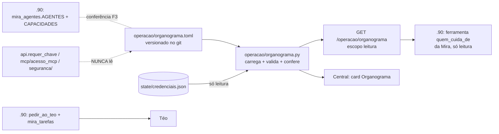

# PLANO — Organograma do escritório (Mira, Téo e as pessoas)

> **Status (02/11/2026):** aprovado com todas as recomendações (D1–D8; D2 = Felipe e Gabriel).
> **F0, F1 e F2 no código.** F1: `operacao/organograma.toml` + `operacao/organograma.py` (revisor isolado
> aplicado). F2: `GET /operacao/organograma[?para=]`, `GET /operacao/organograma/temas/<tema>`, ferramentas
> MCP `organograma` e `quem_cuida_de`, card na página inicial da Central; contrato `docs/ORGANOGRAMA_11.md`.
> **Pede deploy da .11** (API e MCP). **F3 no código do .90** (repo `web_orcaview`, branch
> `ccr-0586ccf4-0jx19d`, V118.1451, commits `98e715d` + `3492c8d`; revisor de código de lá aplicado) —
> **falta o merge e o deploy, a .11 antes do .90**.
> **Reconciliado com o .90 em 02/11/2026** (seção abaixo; Marcelo escolheu "reconciliar primeiro"): F3 virou
> uma ferramenta de leitura + uma conferência entre os dois cadastros, sem mexer no prompt; F4 (repasse na
> .11) e F5 foram **canceladas** — o .90 já tem o repasse (`pedir_ao_teo` + `mira_tarefas`).

**Começo → Meio → Fim:** cada agente e cada pessoa ganha uma ficha por escrito (cargo, o que faz, o
que não faz, a quem escala) → a .11 lê, confere com as credenciais e serve a ficha → a Mira responde
"quem cuida disso?" e "quem aprova quando o Marcelo não está?" lendo a ficha, e o cadastro de agentes do
.90 e o organograma da .11 são conferidos um contra o outro.

## Reconciliação com o .90 (02/11/2026)

Este plano foi escrito sem ver o repo do .90. Quando ele entrou na sessão, apareceu que o "escritório" já
existe lá, mais maduro do que o plano supunha (`docs/PLANO_CENTRO_OPERACAO_ESCRITORIO.md`, etapas E0–E7):

| O que o plano previa | O que o .90 já tem | Quem fica com o quê |
| --- | --- | --- |
| Ficha do agente (cargo, o que faz, o que não faz) | `services/mira_agentes.py` (`AGENTES`: papel, `quem_e`, versão; `CAPACIDADES`: cada ferramenta com **um dono**, compartilhada e substitutos) + `docs/agentes/<id>/SOUL.md`/`REGRAS.md` com versão travada por hash | **.90** é a fonte do que cada agente faz e de qual ferramenta é de quem |
| Seção "Seu cargo" no prompt | Prompts versionados, bancos de teste antes de mudar, WhatsApp congelado (decisão 1 de lá) | **Não muda o prompt.** O `texto_cargo` da F2 fica disponível, mas não entra no prompt |
| Repasse Mira → Téo (F4) | `pedir_ao_teo` + `services/mira_tarefas.py` (SQLite durável: quem pediu, quem responde, prazo, resultado); despacho "Pedir ao Téo" pela tela (E3b); `pedir_a(agente)` previsto na E6 | **.90**. A tabela `tarefas` da .11 **não será criada** |
| Medir o roteamento (F5) | `services/mira_metas.py` (metas do dia no cartão da manhã, E7) | **.90** |
| Pessoas, papéis de quem aprova, substitutos do diretor, temas em linguagem de gente | Não existe (o `.90` conhece o dono pelo `MIRA_OWNER_JID` e o papel pelo `X-SIS-Papel`) | **.11** (`organograma.toml`) |
| Conferir cargo × credencial da .11 | Não existe | **.11** (`conferir`, card da Central) |

Ajustes feitos na ficha por causa do que o .90 mostrou:

- **Mira e `servico:reiniciar` não é sobra:** no .90 a capacidade `encaminhar_reinicio` é da Mira ("só repassa
  ao Téo o reinício que uma pessoa pediu") e ela é a substituta verificada do Téo em `reiniciar_servico`. A
  ficha passa a esperar esse escopo e a ação `reiniciar_servico`; o `nao_faz` diz "por conta própria". A
  conferência da Mira fica verde (D8 resolvida pelo código, não por gosto).
- **A Lia entra no organograma** (agente de Marketing do .90, E6), sem credencial da .11 (ela não fala com a
  .11). Agente sem credencial é aceito quando não pede nada nem espera escopo; a conferência diz
  `sem_acesso_a_11` e não reprova. Tema novo `marketing` (dona Lia, substituto Marcelo — a confirmar).

## A regra inegociável

> **O cargo nunca dá permissão.** A ficha decide **para quem vai** e **como a agente se apresenta**.
> Quem decide **o que pode rodar** continua sendo o que já existe: escopos da credencial
> (`seguranca/credenciais.py`), `PROIBIDOS_AO_AGENTE`, `acoes_agente.CATALOGO` + `pode_aprovar`,
> o interruptor e o horário (`seguranca/agente.py`).

Consequências que o plano trava em código e teste:

1. **Nenhum caminho de autorização lê o organograma.** `seguranca/`, `mcp/acesso_mcp.py` e o
   `requer_chave` do `api.py` não importam `operacao.organograma` (teste por AST, F1).
2. **Ficha que promete mais do que a credencial dá = vale a credencial.** A conferência (F1) aponta a
   diferença; ninguém ganha escopo por estar na ficha.
3. **Ficha que promete menos do que a credencial dá = só aviso.** "Segurança acrescenta, nunca tira
   função": a conferência **nunca revoga** nada. Tirar escopo é decisão do Marcelo, à mão, com
   `python -m seguranca`.
4. **Quem aprova não sai da ficha.** O papel de quem decide (`X-SIS-Papel`, `PAPEIS_PCP`,
   `PAPEIS_ADMIN`) continua vindo de onde vem hoje. A ficha só **descreve** quem aprova o quê, para a
   agente saber a quem pedir.

## Fatos que travam o desenho

1. **As agentes moram no .90** (repo `web_orcaview`; no .90, `web_orcaview_V118`): cadastro, prompts,
   tarefas entre agentes, WhatsApp. O plano tem **duas frentes**: .11 (este repo: ficha das pessoas e dos
   agentes, conferência com credenciais, API) e .90 (a ferramenta de leitura e a conferência entre cadastros).
2. **Só a .11 vê todas as credenciais e todos os pedidos** — é por isso que as aprovações moram aqui.
   Pelo mesmo motivo a ficha mora aqui: é o único lugar onde dá para conferir ficha × credencial.
3. **O repo é público.** A ficha leva cargo, papel e primeiro nome — **nunca** telefone, JID do
   WhatsApp, e-mail ou sobrenome. O contato de cada pessoa continua no `.env` do .90
   (`MIRA_OWNER_JID` e afins), referenciado na ficha por um apelido (`contato = "dono"`).
4. **Sem `pip`**: a ficha é TOML, lida com `tomllib` (stdlib desde o 3.11; a .11 roda 3.14).

## Organograma proposto (para o Marcelo corrigir na F0)

| Quem | Tipo | Cargo | Cuida de | Não faz | Escala para |
| --- | --- | --- | --- | --- | --- |
| **Marcelo** | pessoa | Diretor | Aprova o crítico (`admin`); dono de todo tema sem dono | — | Felipe, Gabriel (D2) |
| **Felipe** | pessoa | Substituto do diretor (D2) | Aprova o crítico quando o Marcelo não está | — | Marcelo |
| **Gabriel** | pessoa | Substituto do diretor (D2) | Aprova o crítico quando o Marcelo não está | — | Marcelo |
| **Mira** | agente | Atendimento, Comercial e PCP | Cliente, orçamento, pedido, entrega, OS, OP (consulta); **pede** processar pedido, encerrar OPs de fechados, forçar carga | Servidor, rede, SAP fora do ar, backup, reinício; nunca aprova; nunca muda data de entrega | Equipe PCP (OP/pedido), Comercial (cliente), Marcelo |
| **Téo** | agente | TI | Serviços da .11, SAP ServerTools, conexões, backup, Hyper-V, Windows Update, logins SAP; **pede** reinício de serviço e do SAP | Pedido, cliente, OP; nunca aprova | Marcelo |
| **Equipe PCP** | pessoas (papel `pcp`) | PCP | Aprova `processar_pedido` e `encerrar_ops_pedidos_fechados` | — | Marcelo |
| **Comercial** | pessoas | Comercial | Pede mudança da data combinada (`entrega:solicitar`) | — | Marcelo |
| **Produção** | pessoas | Produção | Decide as solicitações de data | — | PCP / Marcelo |
| **Anderson** | pessoa | SAP / addon (a confirmar) | `controleproducao/`, addon C# | — | Marcelo |
| **Lia** (02/11) | agente | Marketing | Leads do site, campanhas, Google Ads (só lê; sem acesso à .11) | Mostrar nome/e-mail/telefone de lead; alterar site ou Google Ads | Mira, Marcelo |

**Divergência do 1º dia, resolvida na reconciliação:** a credencial `mira-agente` tem `servico:reiniciar`.
Parecia sobra (reiniciar é da TI), mas o .90 usa esse escopo de propósito: a Mira encaminha o reinício que uma
**pessoa** pediu e é a substituta verificada do Téo. A ficha passou a esperá-lo.

### Temas (o roteamento)

Cada pergunta cai num tema; cada tema tem **um** dono e um substituto. Tema desconhecido = Marcelo.

| Tema | Dono | Substituto | Exemplo de pergunta |
| --- | --- | --- | --- |
| `atendimento` | Mira | Comercial | "o cliente X ligou cobrando" |
| `orcamento` | Mira | Comercial | "o orçamento 1234 virou pedido?" |
| `pedido` | Mira | PCP | "em que pé está o pedido 84000?" |
| `entrega` | Mira | Produção | "dá para antecipar a entrega?" |
| `op` | Mira | PCP | "as OPs do pedido foram liberadas?" |
| `ti_servidor` | Téo | Marcelo | "a Central está fora", "o SAP caiu" |
| `ti_acesso` | Téo | Marcelo | "não consigo logar no SAP" |
| `ti_backup` | Téo | Marcelo | "o backup rodou?" |
| `marketing` (02/11) | Lia | Marcelo (a confirmar) | "quantos leads o site trouxe?" |
| `aprovacao_critica` | Marcelo | Felipe, Gabriel | pedido com papel `admin` |
| `outro` | Marcelo | Felipe, Gabriel | o que não casou com nenhum |

## Arquitetura

## Fases

### F0 — A ficha por escrito (Marcelo; ~meio dia; nenhum código)

**Goal:** `operacao/organograma.toml` existe, revisado pelo Marcelo, com as decisões D1–D8 tomadas.

**Feito (02/11/2026):** o arquivo é `operacao/organograma.toml` — ele é a fonte; o cabeçalho explica
cada campo. Resumo do formato:

- `[[membro]]` com `id`, `tipo` (`agente` | `pessoa` | `equipe`), `nome`, `cargo`, `cuida_de` (os temas de que
  é **dono**), `nao_faz`, `escala_para`.
- Só agente: `credencial`, `pede` (ações do `CATALOGO`), `escopos_esperados`, `apresentacao`.
- Só pessoa/equipe: `aprova` (papéis: `admin`, `pcp` — descreve, não autoriza) e `contato` (apelido).
- `[[tema]]` com `id`, `dono`, `substitutos`, `descricao`, `exemplos`.
- O substituto do diretor (D2) é o `escala_para` do Marcelo e os `substitutos` dos temas
  `aprovacao_critica` e `outro`.
- Agente sem `credencial` (a Lia) não fala com a .11: não pode ter `pede` nem `escopos_esperados`.

### F1 — Leitor, validação e conferência (.11; ~1 dia) — **feito 02/11/2026**

> **Como ficou** (o que mudou em relação ao texto abaixo):
> - API pública: `carregar()`, `situacao()`, `ler(texto)`/`de_dados(dict)` (validam), `conferir(org)` e
>   `Organograma.quem_cuida_de(tema)`. Não há `validar()` solto: carregar já valida.
> - Regras a mais: o dono de um tema lista o tema em `cuida_de` (e só o dono); todo tema tem uma pessoa ou
>   equipe na linha; agente nunca tem `aprova`; ação em `pede` exige o escopo dela em `escopos_esperados`;
>   chave desconhecida é erro (pega `escala_pra`); pessoa só com o primeiro nome; `contato` sem dígitos.
> - Laço de escalada só é proibido **entre agentes**; entre pessoas é substituição (Marcelo ⇄ Felipe).
>   (O repasse entre agentes é do .90, `pedir_ao_teo`.)
> - Dado pessoal: `@` em qualquer texto; telefone brasileiro em texto livre (faixa de pedidos passa);
>   10+ dígitos somados em campo de identidade. A mensagem diz **onde**, nunca repete o número.
> - Conferência também reprova credencial **sem a marca de agente** e escopo de `PROIBIDOS_AO_AGENTE`
>   (só um JSON editado à mão chega lá); para agente, `admin` não cobre falta.
> - O teste "ficha dizendo que a Mira tem `admin`" virou "ficha esperando `os:sincronizar` que a credencial
>   não tem → 403": a própria validação já recusa `admin` na ficha de agente (duas travas).
> - Além do AST, um interpretador limpo importa todos os caminhos de autorização e prova que o organograma
>   não foi carregado (pega import indireto e `importlib`).
> - Arquivo salvo com BOM (Bloco de Notas, PowerShell 5.1) é aceito; cache por mtime + tamanho.

**Goal:** `operacao/organograma.py` carrega a ficha, recusa ficha inconsistente e compara com as
credenciais **sem escrever nada**.

- `carregar()` com `tomllib`; cache por `mtime` (editar o arquivo e dar `git pull` basta, sem restart).
- `validar()` — erro de carga, e a .11 segue com a **última ficha válida** (nunca "sem cargo"):
  - todo `tema.dono`, `substituto` e `escala_para` aponta para um `membro.id` existente;
  - toda cadeia de escalada termina numa **pessoa** e não tem ciclo;
  - todo item de `pede` existe no `acoes_agente.CATALOGO`;
  - todo `escopos_esperados` existe em `ESCOPOS`; agente nunca lista `PROIBIDOS_AO_AGENTE`;
  - nenhum campo com cara de telefone/e-mail/JID (regex; o repo é público);
  - existe o tema `outro`.
- `conferir()` — lê `credenciais.carregar()` (só leitura) e devolve, por agente:
  `faltam` (ficha espera, credencial não tem — a ação falharia), `sobram` (credencial tem, cargo não
  prevê — aviso, nunca revoga), `sem_credencial`, `credencial_sem_ficha`.
- CLI: `python -m operacao.organograma` (tabela) e `... conferir` (sai 1 se houver `faltam`).
- Testes `tests/test_organograma.py`:
  - ficha do repo é válida (o teste quebra se alguém editar errado — é o gate);
  - cada regra do `validar()` com uma ficha quebrada;
  - **a regra inegociável**: ficha dizendo que a Mira tem `admin` → `requer_chave` continua 403;
  - **por AST**: `seguranca/*.py`, `mcp/acesso_mcp.py` e o `requer_chave` não importam nem referenciam
    `organograma`;
  - `conferir()` nunca chama `criar`/`acrescentar`/`revogar` (monkeypatch que explode);
  - `servico:reiniciar` da Mira aparece em `sobram` (o caso real acima).

### F2 — A ficha para quem pergunta (.11; ~meio dia) — **feito 02/11/2026**

> **Como ficou:** a `conferencia` vai **só para administrador** (Central, chave-mestra) — mais fechado que o
> texto abaixo: que escopo cada agente tem não é para todo cliente com `leitura`. `?para=<agente>` já traz o
> `texto_cargo` pronto (a seção "Seu cargo" da F3, com a regra na última linha), então o .90 não monta texto.
> Tema desconhecido não é 404: vai para `outro` (`casou: false`). Arquivo inválido sem versão boa → 503.
> Testes: `tests/test_api_organograma.py`, `tests/test_mcp_organograma.py`.

**Goal:** as agentes e a Central leem a ficha pela API; a conferência fica visível.

- `GET /operacao/organograma` — `@requer_chave('leitura')`: membros, temas, versão, `conferencia`
  (só nomes de escopo, nunca hash) e `valida_desde`. Com `?para=mira` devolve só a ficha dela + os
  temas (o que vai no prompt).
- Ferramentas MCP `organograma` e `quem_cuida_de(tema)` com `leitura` no `ESCOPO_DA_FERRAMENTA`.
- Card "Organograma" na página inicial da Central (`web/inicio.html`) com a conferência em amarelo
  quando houver `faltam`/`sobram`. Sem check novo no `/status` na v1 (D8).
- Contrato curto em `docs/ORGANOGRAMA_11.md` (mesmo commit da rota) + linha no mapa do `CLAUDE.md`.
- Testes em `tests/test_api.py` / `tests/test_api_seguranca.py`: escopo declarado, sem credencial →
  401/403, `?para=` desconhecido → 404.

### F3 — A Mira lê o organograma; os dois cadastros se conferem (.90; ~1 dia) — **feito 02/11/2026**

> **Como ficou:** módulo próprio `services/mira_organograma.py` (o molde das ferramentas só da tela: ações,
> Lia, manuais), não `mira_infra`. A ferramenta entrou no **núcleo da tela**, ao lado de `quem_pode_ver`, e
> não numa sala própria: sala nova muda as descrições que o seletor lê, e o teste do .90 exige medir o
> seletor antes (`tools/dev/mira_avaliar_seletor.py --tela`, que usa o LM Studio do .90). **Limite disso:**
> pergunta que o seletor manda para "Geral" ("quem aprova quando o Marcelo não está?") não abre o modo com
> ferramentas, então a Mira não a usa ali. **Próximo passo opcional (no .90):** criar a sala "Organograma"
> (`so_tela=True`) e rodar a medição. Vale para as três empresas (`DAS_TRES`: sem dado de empresa). Conferência
> entre cadastros: `backend/tests/test_mira_organograma.py` sobre `tests/data/organograma_11.json`
> (`python tools/dev/organograma_11.py --toml <esta pasta>/operacao/organograma.toml` quando a ficha mudar).

**Goal:** a Mira responde "quem cuida disso?", "quem aprova quando o Marcelo não está?" e "a quem eu passo
isso?" lendo a ficha da .11 — sem mudar o prompt — e um teste do .90 avisa quando o cadastro de agentes de lá
e o organograma daqui discordam.

- **Ferramenta de leitura `quem_cuida_de`** no catálogo da Mira (capacidade `atender`, efeito `leitura`),
  pelo mesmo caminho das outras leituras da .11 (`mira_infra`, chave da Mira): sem argumento devolve o
  organograma resumido (pessoas, agentes, temas, substitutos); com `tema` devolve o dono e os substitutos.
  Contrato em `mira_contratos`, versão da Mira sobe, tabelas de autorização e de rotina regeneradas só com o
  nome novo (o molde é o `pedidos_fechados_com_op`, V118.1329). O prompt não muda: a descrição da ferramenta
  é o que o modelo lê.
- **Conferência entre os cadastros** (`tests/test_organograma_11.py` no .90), contra uma cópia
  `tests/data/organograma_11.json` gerada por `tools/dev/organograma_11.py` a partir deste repo:
  todo agente da .11 existe no `AGENTES` do .90; toda ação que a ficha diz que um agente **pede** é uma
  ferramenta do .90 de que ele é dono, compartilhado ou substituto; tema de agente aponta para um agente que
  existe. A cópia é dado, não regra: quando a .11 muda a ficha, regenera-se a cópia e o teste diz o que
  discorda.
- **WhatsApp:** fica como está (congelado lá). A ferramenta nova só aparece onde as habilidades da Mira já
  aparecem; se o canal congelado tiver lista própria de ferramentas, ela não entra nele.

### F4 e F5 — canceladas (02/11/2026)

O repasse entre agentes, o registro de tarefas e a medição já existem no .90 (tabela da reconciliação). O que
sobrar de "tarefas para pessoas" vai como proposta para o `PLANO_CENTRO_OPERACAO_ESCRITORIO` do .90, não como
tabela nova aqui (`docs/PLANO_QUADRO_TAREFAS.md`, reescrito).

## O que NÃO muda

- `seguranca/credenciais.py`, `aprovacoes.py`, `agente.py`, `PROIBIDOS_AO_AGENTE`, `acoes_agente.CATALOGO`
  e o `aprovacoes.db`: zero linhas alteradas. Os testes atuais deles passam sem mudança — é o sinal.
- Nenhum escopo é retirado nem criado. Nenhuma escrita no SAP nem tabela nova na .11.
- No .90: prompts, `SOUL.md`/`REGRAS.md`, WhatsApp e tarefas entre agentes ficam como estão.

## Riscos e como o plano responde

| Risco | Resposta |
| --- | --- |
| A ficha virar permissão "pela porta dos fundos" | Regra inegociável + teste por AST + teste do 403 |
| Dois cadastros discordarem (.90 × .11) | Conferência da F3 no .90, contra a cópia regenerada |
| Ficha errada derrubar as agentes | Validação + última ficha válida; teste da ficha do repo é gate do commit |
| Dado pessoal num repo público | Só cargo/papel/1º nome; validador recusa telefone/e-mail/JID |
| Diretor como gargalo único | D2: Felipe e Gabriel substituem; o papel `admin` deles vem do .90, não da ficha |

## Execução sugerida (subagentes)

- **F1+F2** (.11): um agente Sonnet numa worktree isolada, com este plano e os arquivos
  `operacao/acoes_agente.py`, `seguranca/credenciais.py`, `tests/test_api_seguranca.py`.
- **Haiku** só em tarefas de leitura: varrer o .90 atrás de texto de cargo escrito à mão nos prompts,
  listar onde cada escopo é usado, revisar o português das fichas. **Nada em `seguranca/` nem em código
  de concorrência com Haiku.**
- **Revisor isolado** (sem ver a conversa, só o diff + este plano) antes de cada merge, como no plano
  dos pedidos fechados.
- **F3 .90**: repo `web_orcaview` (no .90 a pasta é `web_orcaview_V118`), revisor `revisor-codigo` de lá.
  Ordem de deploy: **.11 antes do .90** (a ferramenta chama a rota nova).

## Decisões para o Marcelo

| # | Pergunta | Recomendação |
| --- | --- | --- |
| D1 | Onde mora a ficha? | `operacao/organograma.toml` no git deste repo (histórico, revisão, conferência com credenciais). Alternativas: Supabase (edita sem commit, perde o gate) ou .90 (não confere credenciais) |
| D2 | Quem substitui o diretor nas aprovações críticas? | **Decidido (02/11/2026): Felipe e Gabriel.** Na ficha só o primeiro nome (repo público, D7). A ficha só descreve: para eles aprovarem de fato, o .90 tem de mandar `X-SIS-Papel: admin` quando a decisão vier deles (regra 4) — passo à parte, no .90, feito pelo Marcelo |
| D3 | Os temas e donos da tabela acima estão certos? | Começar com esses 10; ajustar na F5 com os números |
| D4 | O repasse grava registro? | ~~Tabela na .11~~ — **superada (02/11):** o registro é o `mira_tarefas` do .90 |
| D5 | Repasse fora de seg–sex 07–19h? | **Superada (02/11):** o repasse é do .90 e segue as regras de lá |
| D6 | Quantos saltos até uma pessoa? | **Superada (02/11):** idem |
| D7 | Pessoas pelo nome ou pelo papel? | Papel + primeiro nome; contatos só no `.env` do .90 (repo público) |
| D8 | Divergência ficha × credencial (ex.: `servico:reiniciar` da Mira)? | Só relatório no card da Central. **O caso da Mira foi resolvido (02/11):** o .90 usa esse escopo de propósito (encaminhar o pedido de uma pessoa; substituta do Téo) — a ficha passou a esperá-lo |
