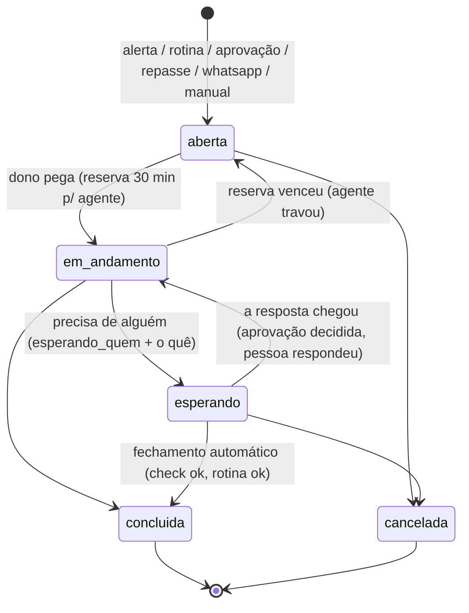
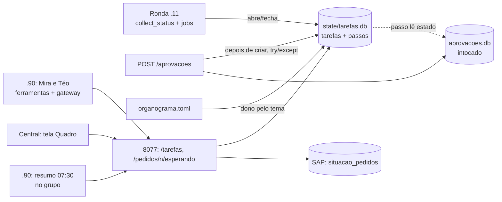

# PLANO — Quadro de Tarefas do escritório

> **Status (02/11/2026):** rascunho para tirar dúvidas do Marcelo. **Não aprovado; nada no código.**
> Depende do `PLANO_ORGANOGRAMA.md`: a tabela `tarefas` nasce lá (F4, repasse) e este plano a completa.
> Ordem recomendada: Organograma F1–F5 → este plano, com os números da F5 na mão.

**Em uma frase:** tudo o que o escritório precisa lembrar e que **não está em sistema nenhum** — "prometi
retorno ao cliente", "o backup falhou", "esperando o PCP aprovar" — vira uma linha com dono, próxima ação
e "esperando quem", e a maioria dessas linhas nasce **sozinha**, sem depender de a agente lembrar.

## O que muda para quem usa

| Hoje | Com o quadro |
| --- | --- |
| A Mira esquece a conversa de ontem; "o que ficou pendente?" não tem resposta | Pendência é linha no quadro; a Mira lê e responde |
| A aprovação é a única coisa registrada | A aprovação vira **um passo** de uma tarefa (ex.: "processar o pedido 84000": pedir → aprovar → conferir OPs) |
| Alerta da .11 some quando o serviço volta, sem rastro | Alerta abre tarefa do Téo; quando o check volta a `ok`, ela **fecha sozinha** com o tempo que durou |
| "Esse pedido está esperando quem?" = alguém abre SAP, CP e WhatsApp | Uma resposta que junta o SAP (estado) com o quadro (o que é humano) |
| Ninguém sabe o que a Mira e o Téo fizeram ontem | Resumo da manhã no grupo: o que abriu, fechou, está parado e espera você |

## Um dia no escritório (exemplo)

1. **07:02** — a ronda da .11 vê o backup do Veeam com falha. Abre a tarefa **T-0412** "Backup do ALTHOST
   falhou", dono **Téo** (tema `ti_backup`), origem `alerta`. Ninguém digitou nada.
2. **07:30** — resumo no grupo: "3 abertas (1 nova do Téo), 1 parada há 3 dias: *retorno ao cliente X —
   Comercial*".
3. **09:10** — cliente pergunta à Mira pelo pedido 84000. Ela consulta o SAP (estado real) **e** o quadro:
   existe a **T-0398** "Processar pedido 84000", esperando **PCP** aprovar o código 4821. Resposta: "o pedido
   está aguardando a liberação do PCP, pedida às 08:40".
4. **09:25** — o PCP aprova `4821`. O passo "aprovação" da T-0398 fica `executado`; a tarefa passa para a
   próxima ação "conferir as OPs criadas" e continua com a Mira.
5. **10:00** — alguém pergunta à Mira "a VPN caiu?". Pelo organograma é `ti_servidor`: vira repasse para o
   Téo (**T-0415**) com o resumo da conversa; a pessoa não repete nada.
6. **11:40** — o backup roda de novo e o check volta a `ok`: a T-0412 fecha sozinha ("durou 4h38").
7. **18:00** — a conversa de um cliente ficou sem desfecho há 30 min; o .90 abre **T-0419** "Cliente Y
   esperando retorno sobre prazo", dono Mira, substituto Comercial.
8. **Dia seguinte, 07:30** — "o que ficou pendente ontem?": T-0398 (conferir OPs), T-0415 (Téo), T-0419.

## As 4 ressalvas viram regras de desenho

### R1 — Tabela própria; a aprovação não muda

- `state/tarefas.db` (a mesma do repasse do Organograma F4). O `aprovacoes.db` e o `seguranca/aprovacoes.py`
  **não mudam uma linha**: "o agente nunca aprova" continua guardado só por eles.
- A ligação é por id: a tabela `passos` aponta `aprovacao_id`. Quem liga é a **rota** `POST /aprovacoes`
  do `api.py`, depois que a aprovação já foi criada, dentro de `try/except`: **o quadro fora do ar nunca
  impede uma aprovação** (só loga ERRO).
- O estado do passo é lido da aprovação (fonte única), não copiado.
- "Pegar a tarefa" (o checkout do Paperclip) = o mesmo padrão do `aprovacoes.criar`: um `UPDATE ... WHERE
  reservado_ate < agora` atômico, com **prazo** (30 min, renovável). Agente que travou devolve a tarefa à
  fila sozinho, como os órfãos de 15 min das aprovações.

### R2 — O quadro não copia o SAP

- Tarefa guarda **links** (`pedido`, `op`, `orcamento`, `aprovacao_id`), nunca o estado deles.
- "Esse pedido está esperando quem?" = `GET /pedidos/<n>/esperando` **compõe na hora**:
  `situacao_pedidos` (SAP) + aprovações abertas do pedido + solicitações de `entrega_combinada` + tarefas
  abertas com `pedido = n`. Nada disso é guardado de novo.
- Teste que protege: a tabela não tem coluna de status do SAP; uma tarefa com `pedido` não muda quando o
  pedido muda no SAP.

### R3 — A tarefa nasce sozinha (o modelo é complemento)

| Origem | Quem cria | Quando fecha |
| --- | --- | --- |
| `alerta` | ronda da .11 (agendador, 5 min) lendo `collect_status`; um aberto por check | sozinha, quando o check volta a `ok` |
| `rotina` | job do agendador que falhou (Vendas BI, espelho, `arquivo_pedidos`) | sozinha, no próximo sucesso |
| `aprovacao` | a rota `POST /aprovacoes` (pedido de agente ou pessoa) | quando o último passo termina |
| `repasse` | Organograma F4 (pergunta no tema de outro) | quem recebe conclui |
| `whatsapp` | o gateway do .90: conversa sem desfecho há 30 min (regra do .90, não do modelo) | a Mira ou o substituto conclui |
| `manual` | pessoa na Central ou agente por ferramenta | quem é dono conclui |

Deduplicação igual às aprovações: um aberto por `(origem, alvo)` — o mesmo alerta piscando não abre dez.

### R4 — Pequeno, com cobrança

- **5 estados:** `aberta` → `em_andamento` → `esperando` → `concluida` | `cancelada`.
- **Obrigatórios:** `titulo`, `dono`, `proxima_acao`, e quando `esperando`: `esperando_quem` +
  `esperando_o_que`. Sem isso a API recusa (`400`).
- **Fora da v1:** `meta`, prioridade, prazo, subtarefas, etiquetas. Entram se a F6 mostrar falta.
- **Cobrança:** `parada_desde` (última mudança); > 2 dias úteis entra no resumo da manhã em destaque; > 5
  sobe para o substituto do tema.
- **Tetos:** agente cria no máximo 30/h; interruptor e horário de `seguranca/agente.py` valem (é escrita de
  agente). Retenção: concluídas somem em 90 dias.

## Ciclo de vida

## Arquitetura

## Tabelas (v1)

**`tarefas`** — `id`, `codigo` (`T-0412`), `titulo`, `origem`, `alvo` (chave da deduplicação), `tema`,
`dono` (`membro.id` do organograma), `estado`, `proxima_acao`, `esperando_quem`, `esperando_o_que`,
`pedido`, `op`, `orcamento`, `conversa_ref`, `reservado_por`, `reservado_ate`, `saltos` (do repasse),
`criada_por`, `em_nome_de`, `criada_em`, `parada_desde`, `concluida_em`, `desfecho`.

**`passos`** — `tarefa_id`, `ordem`, `descricao`, `aprovacao_id` (opcional), `feito_em`, `feito_por`.

**`historico`** — toda mudança de estado/dono, com quem e quando (é ele que responde "o que aconteceu
ontem" e mede o tempo parado).

## Fases

| Fase | O quê | Onde | Tamanho |
| --- | --- | --- | --- |
| Q0 | Decisões abaixo; **quem olha o quadro todo dia** tem nome | Marcelo | — |
| Q1 | Tabelas completas sobre o `tarefas.db` do Organograma F4; API `/tarefas` (listar, abrir, pegar, mudar estado, concluir) com escopos `tarefas:ler` e `tarefas`; dedup; reserva com prazo; histórico | .11 | ~2 dias |
| Q2 | **Criação automática** (alerta, rotina, aprovação) com fechamento automático — o maior valor, sem modelo nenhum | .11 | ~1–2 dias |
| Q3 | Tela "Quadro" na Central (por dono, parado em destaque) + `GET /tarefas/resumo` | .11 | ~1 dia |
| Q4 | Mira e Téo: ferramentas MCP (`tarefas_abertas`, `abrir_tarefa`, `pegar_tarefa`, `atualizar_tarefa`), conversa sem desfecho, resumo das 07:30 | .90 | ~2 dias |
| Q5 | `GET /pedidos/<n>/esperando` (compõe SAP + aprovações + entrega + quadro) | .11 | ~1 dia |
| Q6 | 30 dias de uso medido: abertas/fechadas por origem, tempo parado, quantas a tela abriu | — | 30 dias |

**Critério de desistência (honesto):** se ao fim da Q6 a tela do quadro foi aberta em menos da metade dos
dias úteis e o resumo da manhã não gerou ação, o quadro volta a ser só o registro de repasses e alertas — sem
tela, sem ferramenta nova para as agentes.

## O que NÃO muda

- `seguranca/` inteiro (credenciais, aprovações, agente) — os testes atuais passam sem mudança.
- Nenhuma escrita no SAP; nenhum escopo retirado de ninguém.
- O organograma continua sem dar permissão: o `dono` de uma tarefa não ganha escopo por ser dono.

## Decisões para o Marcelo

| # | Pergunta | Recomendação |
| --- | --- | --- |
| Q-D1 | Quem olha o quadro todo dia? | Uma pessoa nomeada (sugestão: você na v1, Felipe/Gabriel na ausência). Sem nome, não construir |
| Q-D2 | Escopo do quadro | `tarefas:ler` separado de `leitura` (o resumo da conversa traz dado de cliente, como a `entrega:ler`) e `tarefas` para escrever. **O `repasse` do Organograma F4 passa a ser este `tarefas`** — um escopo só |
| Q-D3 | Ronda de alertas: a cada quanto? | 5 min no agendador, 24/7 (só abre/fecha linha; não mexe em nada) |
| Q-D4 | Tarefa parada: quando cobra e quando sobe? | Destaque com 2 dias úteis; sobe para o substituto com 5 |
| Q-D5 | Conversa sem desfecho no WhatsApp vira tarefa? | Sim, por regra do gateway (30 min sem resposta final), não por decisão do modelo |
| Q-D6 | Retenção | Concluídas 90 dias; histórico junto |
