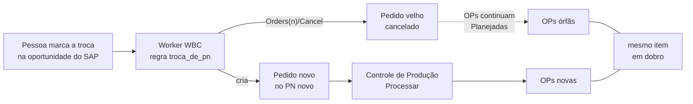

# Plano — Troca de PN não pode deixar OP órfã

> **Status (20/10/2026):** só plano, nada codado. Hoje há **110 OPs planejadas presas a dois pedidos
> cancelados** (84505 e 84506), e os pedidos que os substituíram (84507 e 84510) já têm as suas OPs:
> **produção em dobro planejada**. A limpeza dos dois casos (F0) já pode ser feita com o comando que existe.
> F1–F4 esperam a decisão 1.
> Página: https://claude.ai/artifact/LQMScG4RVLRNwB6MXqq8Ui (mesma url a cada atualização)

## O problema

Quando alguém marca a troca de parceiro na **oportunidade do SAP** (`U_INO_PN_Correc` com o PN novo e
`U_INO_Update = 'Y'`), o worker WBC → SAP aplica a regra `troca_de_pn`: **cancela o pedido e cria
outro** no PN novo (`domain/sitcode.py::_decidir_pedido` → `Acao.CANCELAR_E_RECRIAR_PEDIDO` →
`service_layer/documentos.py::cancelar_e_recriar`). Ele não olha se o pedido já foi processado no
Controle de Produção. O SAP aceita cancelar pedido de venda com OP vinculada sem erro nenhum.

Resultado: as OPs do pedido velho continuam **Planejadas** (`OWOR.OriginAbs` = pedido cancelado), o
pedido novo aparece em "Pedidos novos" do Controle de Produção, alguém o processa, e o mesmo item passa
a ter dois jogos de OP.

## O que o SAP mostrou (20/10/2026, leitura no HANA de produção)

Pedidos de orçamento WBC cancelados desde 28/09/2026 (dia em que o Controle de Produção da .11
entrou no ar):

| Medida | Número |
| --- | --- |
| Pedidos cancelados | **22** |
| Cancelados pela troca de PN (usuário da integração) | **17** |
| Com OP vinculada | **3** — 84476, 84505, 84506 |
| OPs ainda Planejadas em pedido cancelado | **110** — 52 no 84505 e 58 no 84506 |

| Orçamento | Pedido cancelado → novo | OPs do cancelado | OPs do novo |
| --- | --- | --- | --- |
| 00125842 | 84476 → 84481 (14/10) | 4 **Canceladas** (alguém limpou à mão) | 4 Liberadas |
| 00125690 | 84505 → 84507 (20/10) | **52 Planejadas** (158845–158896) | 52 Planejadas (158909–158960) |
| 00124837 | 84506 → 84510 (20/10) | **58 Planejadas** (159019–159076) + 58 Canceladas | 58 Planejadas (159077–159134) |

O 00125690 trocou de PN **duas vezes** no mesmo dia (84503 → 84505 → 84507). No 00124837 a letra da
revisão ficou em J o tempo todo: a troca não depende de revisão nova.

## Fatos que travam o desenho

- **A troca tem que continuar acontecendo.** 15 das 17 trocas foram em pedido sem OP, e trocar PN é
  rotina (18,8% dos pedidos nascem em outro PN que o da cotação, medido em 21/09/2026). Bloquear a
  regra inteira não é opção.
- **O worker não lê nada de OP hoje.** O estado do pedido vem de
  `infrastructure/hana/oportunidades.py` (CardCode, revisão, `U_INO_Congelado`, `DocStatus`). A
  proteção precisa de uma leitura nova: OPs vivas por `OWOR.OriginAbs`.
- **Cancelar OP é escrita de produção.** Hoje só o Controle de Produção cancela OP (Reprocessar e
  `pedidos-wbc cancelar-ops`), sempre com uma pessoa confirmando, e só se todas as OPs estiverem
  Planejadas ou Canceladas. OP Liberada ou Encerrada já pode ter apontamento e estoque.
- **O risco já estava anotado:** o `CLAUDE.md` deste repo diz que "o worker recria pedido sem olhar
  `OWOR`". Este plano fecha esse buraco.
- **Já existe o padrão "para e pede gente":** `troca_de_pn_impossivel_pedido_fechado` registra a
  decisão, não executa nada e espera tratamento manual.
- **O texto da decisão engana.** A mensagem diz "Parceiro corrigido no WBC", mas a marca mora na
  oportunidade do SAP (UDFs `U_INO_PN_Correc` e `U_INO_Update`), preenchida por uma pessoa.

## Opções para o worker (decisão 1)

| | O que faz | A favor | Contra |
| --- | --- | --- | --- |
| **A. Para e avisa** | Pedido com OP viva (Planejada, Liberada ou Encerrada): não cancela; registra `troca_de_pn_bloqueada_pedido_com_op` com a lista de OPs, log em vermelho. Uma pessoa roda `cancelar-ops <pedido>`; no ciclo seguinte, sem OP viva, a troca segue sozinha | Nenhuma escrita nova no worker; mesmo padrão da troca em pedido fechado; idempotente | A troca espera alguém agir |
| **B. Cancela as OPs sozinho** | Todas Planejadas: o worker cancela as OPs, depois o pedido, e cria o novo. Alguma Liberada ou Encerrada: para como em A | Nada fica órfão sem depender de gente | Worker passa a cancelar OP em produção sem confirmação; o pedido novo ainda precisa de alguém para processar; o PCP pode já estar planejando com as OPs velhas |

**Barreira no Processar (decisão 2, soma com A ou B):** o Controle de Produção recusa processar um pedido
quando outro pedido **cancelado** do mesmo orçamento ainda tem OP Planejada ou Liberada, e a recusa diz
quais OPs e o comando para cancelá-las. Fica em `controleproducao/modules/pedidos_wbc/acoes.py`, então
vale para a tela e para a API JSON. Pega também o pedido cancelado à mão no SAP, que o worker não vê.

## Fases

### F0 — Limpar os dois casos de hoje (pessoa; já dá para fazer)

Capacidade: os orçamentos 00125690 e 00124837 ficam com um jogo de OP só.

- Confirmar com a equipe do PCP que valem as OPs dos pedidos **novos** (84507 e 84510).
- Na .11, um pedido por vez, conferindo a tabela antes de confirmar:
  `python -m controleproducao pedidos-wbc cancelar-ops 84505 --manter-vinculos` e o mesmo para 84506.
- `--manter-vinculos` porque o pedido já está cancelado: a limpeza de vínculos grava no pedido, e o SAP
  recusa gravar em pedido cancelado.

### F1 — O worker passa a saber se o pedido tem OP (só leitura)

Capacidade: a decisão do pedido enxerga as OPs vivas.

- `oportunidades.py`: contagem de OPs do pedido vigente por status (`OWOR.OriginAbs`, `Status` P/R/L),
  num `LEFT JOIN` agregado, sem consulta por orçamento.
- `EstadoIntegracao`: campo novo com essa contagem.
- Medir o tempo da consulta da janela antes e depois (ela roda a cada ciclo).

### F2 — A regra (opção escolhida na decisão 1)

Capacidade: troca de PN em pedido com OP não gera mais OP órfã.

- `_decidir_pedido`: antes de `troca_de_pn`, o caso "troca pendente + OP viva".
- Mensagem corrigida: "parceiro corrigido **na oportunidade do SAP**".
- Log em vermelho e a decisão visível na Previsão do painel WBC.
- Testes de regra: troca sem OP (segue como hoje), com OP Planejada, com OP Liberada, com todas Canceladas
  (segue).

### F3 — Barreira no Processar do Controle de Produção

Capacidade: ninguém processa o pedido novo enquanto o velho tem OP viva, nem quando o cancelamento foi
feito à mão.

- Recusa em `acoes.py` (tela e API), com os números das OPs e o comando de F0.
- Teste de paridade tela × API, como os que já existem.

### F4 — No ar e conferido (deploy é do Marcelo)

- Deploy na .11; conferir com `python -m wbcpython pendentes` (o que o ciclo faria, só leitura) e pela
  recusa do Processar num pedido com OP. Nenhuma escrita para provar.

## Decisões

1. **Worker: A (para e avisa) ou B (cancela as OPs sozinho)?** Recomendado: **A**. Cancelar OP sem
   ninguém confirmar é escrita nova e perigosa, e o pedido novo precisa de uma pessoa para processar de
   qualquer forma; essa mesma pessoa cancela as OPs velhas com o comando que já existe.
2. **Barreira no Processar (F3) junto?** Recomendado: **sim**. É barata e fica no ponto onde a
   duplicação acontece de fato; cobre cancelamento à mão.
3. **O que conta como "tem OP"?** Recomendado: **OP com status Planejada, Liberada ou Encerrada em
   `OWOR.OriginAbs`**, ignorando as Canceladas. `U_INO_ProcessWBC = 'Y'` sozinho erra: continua `Y` depois
   que as OPs são canceladas com `--manter-vinculos`.
4. **Quem é avisado quando a troca para?** Recomendado: **painel WBC + log em vermelho** por enquanto;
   aviso ativo (e-mail, Mira) só se o caso se repetir.

## Fora deste plano (achados do mesmo dia)

- **Pedido congelado recebe o cabeçalho da revisão nova:** no 84506, às 14:25, a revisão J desfez duas
  edições manuais do cabeçalho (observações e valor da montagem). É o comportamento do legado, documentado
  em `processar.py::_respeitar_congelamento`.
- **Mudança no WBC depois das OPs não chega às linhas do pedido congelado** (cor, por exemplo).
  Reprocessar refaz só as OPs.
- **`preenche_tabela` falhou no Processar das 15:06 do 84506** ("Erro em preenche_tabela"); a causa está
  no log do Controle de Produção na .11 e não foi lida.

---
Plano: ServidorIntegracaoSAP (.11) · 2026-10-20
