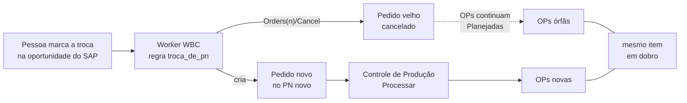

# Plano — Troca de PN não pode deixar OP órfã

> **Status (20/10/2026):** decisões 1–4 fechadas (1 = **B, o worker cancela as OPs planejadas sozinho**,
> escolha do Marcelo). **F0a feita (20/10):** as 110 OPs Planejadas dos cancelados 84505 e
> 84506 foram canceladas; conferido por amostra (7 OPs, incluindo a primeira e a última de cada faixa) e as
> dos pedidos novos 84507 e 84510 continuam Planejadas. **F0b e F0c decididas (cancelar tudo), mas ainda
> não aplicadas:** leitura completa do SAP às ~17h10 de 20/10 ainda mostra 83832 com 40 Planejadas e os 6
> pedidos com as 250 Liberadas. **F1 no ar** na .11 (`8617f4c`, deploy 17:02), sem custo de tempo medido.
> **F2 no código** (20/10, revisada por um revisor independente, 6 achados corrigidos), **pede deploy**;
> nunca exercitada contra o SAP real (só roda numa troca de verdade). **F3 no código** (21/10, revisão
> independente "nada grave"), **pede deploy** — ao subir, barra os pedidos novos dos orçamentos que ainda têm
> cancelado com OP viva (F0b/F0c). **F4: deploy `dfdb664` conferido em 21/10** (F1–F3 no ar; recusa da F3
> e caminho da F2 ainda sem caso real). **Pendente: F0b/F0c.**
> Página: https://claude.ai/artifact/LQMScG4RVLRNwB6MXqq8Ui (mesma url a cada atualização)

## O problema

Quando alguém marca a troca de parceiro na **oportunidade do SAP** (`U_INO_PN_Correc` com o PN novo e
`U_INO_Update = 'Y'`), o worker WBC → SAP aplica a regra `troca_de_pn`: **cancela o pedido e cria
outro** no PN novo (`domain/sitcode.py::_decidir_pedido` → `Acao.CANCELAR_E_RECRIAR_PEDIDO` →
`service_layer/documentos.py::cancelar_e_recriar`). Ele não olha se o pedido já foi processado no
Controle de Produção. O SAP aceita cancelar pedido de venda com OP vinculada sem erro nenhum.

Resultado: as OPs do pedido velho continuam **Planejadas** (`OWOR.OriginAbs` = pedido cancelado), o
pedido novo aparece em "Pedidos novos" do Controle de Produção, alguém o processa, e o mesmo item passa
a ter dois jogos de OP.

## O que o SAP mostrou (20/10/2026, leitura no HANA de produção)

**Trocas desde 28/09/2026** (dia em que o Controle de Produção da .11 entrou no ar): 22 pedidos de
orçamento WBC cancelados, **17** pela troca de PN, **3** com OP.

| Orçamento | Pedido cancelado → novo | OPs do cancelado | OPs do novo |
| --- | --- | --- | --- |
| 00125842 | 84476 → 84481 (14/10) | 4 **Canceladas** (alguém limpou à mão) | 4 Liberadas |
| 00125690 | 84505 → 84507 (20/10) | **52 Planejadas** (158845–158896) | 52 Planejadas (158909–158960) |
| 00124837 | 84506 → 84510 (20/10) | **58 Planejadas** (159019–159076) + 58 Canceladas | 58 Planejadas (159077–159134) |

O 00125690 trocou de PN **duas vezes** no mesmo dia (84503 → 84505 → 84507). No 00124837 a letra da
revisão ficou em J o tempo todo: a troca não depende de revisão nova.

**Todas as OPs vivas em pedido cancelado, sem limite de data:**

| Status da OP | OPs | Pedidos cancelados | O que fazer |
| --- | --- | --- | --- |
| Planejada | **150** | 3 — 84505 (52), 84506 (58), 83832 (40) | F0: cancelar |
| Liberada | **250** | 6 — 84023 (98), 84116 (73), 83958 (40), 84179 (31), 84162 (7), 84103 (1) | F0: o PCP analisa uma a uma |
| Encerrada | 2.769 | 82, de 09/2023 a 07/2026 | nada: produção já fechada, é histórico |

Buscar também por `OWOR.OriginNum` (número do pedido) não acha nenhuma OP viva a mais: `OriginAbs` basta.

## Fatos que travam o desenho

- **A troca tem que continuar acontecendo.** 15 das 17 foram em pedido sem OP, e trocar PN é rotina
  (18,8% dos pedidos nascem em outro PN que o da cotação, medido em 21/09/2026).
- **O worker não lê nada de OP hoje.** O estado do pedido vem de
  `infrastructure/hana/oportunidades.py` (CardCode, revisão, `U_INO_Congelado`, `DocStatus`). O
  `CLAUDE.md` deste repo já dizia que "o worker recria pedido sem olhar `OWOR`".
- **OP Liberada ou Encerrada não se cancela no automático.** Pode já ter apontamento e estoque; o
  `cancelar-ops` do Controle de Produção também recusa.
- **O Controle de Produção marca `U_INO_ProcessWBC = 'Y'` antes de criar a 1ª OP** e uma execução leva
  de segundos a minutos (84506: 25 s). O worker não pode cancelar no meio disso: a 8080 diz se está
  ocupada em `GET /health/ocupado` ("1" ou "0", rota aberta, a mesma que o `deploy_update.bat` usa).
- **Teto de escrita do ciclo: 200 orçamentos** (`LIMITE_DE_ESCRITA_POR_CICLO`). Conferido no
  `host/worker.py`: o teto conta **orçamentos** com escrita, não gravações; as OPs canceladas de um pedido
  entram como uma escrita só. Erro no meio dos cancelamentos continua sendo o caso a tratar.
- **O texto da decisão engana.** A mensagem diz "Parceiro corrigido no WBC", mas a marca mora na
  oportunidade do SAP, preenchida por uma pessoa.

## Opção escolhida para o worker (decisão 1)

| | O que faz | Situação |
| --- | --- | --- |
| A. Para e avisa | Pedido com OP viva: não cancela; uma pessoa roda `cancelar-ops` e a troca segue no ciclo seguinte | não escolhida |
| **B. Cancela as OPs sozinho** | Só Planejadas: o worker cancela as OPs, depois o pedido, e cria o novo. Alguma Liberada ou Encerrada: para e avisa | **escolhida (20/10, Marcelo)** |

Travas da B (todas em F2): só OP Planejada; para em Liberada/Encerrada; adia se o Controle de Produção
estiver ocupado; relê as OPs na hora, não confia no início do ciclo; nunca cancela o pedido com OP viva;
registra no painel os números das OPs canceladas, para o PCP saber.

**Barreira no Processar (decisão 2):** o Controle de Produção recusa processar um pedido quando outro
pedido **cancelado** do mesmo orçamento ainda tem OP Planejada ou Liberada, e a recusa diz quais OPs e o
comando para cancelá-las. Fica em `controleproducao/modules/pedidos_wbc/acoes.py`, então vale para a tela
e para a API JSON. Pega o pedido cancelado à mão no SAP e o caso em que o worker parou por OP Liberada.

## Fases

### F0 — Limpar as OPs vivas de pedidos cancelados (Marcelo + PCP; já dá para fazer)

Capacidade: nenhum orçamento com produção em dobro planejada; o que sobrar é decisão consciente do PCP.

**F0a — hoje, urgente (110 Planejadas). ✅ Feita em 20/10 (Marcelo, na .11).** Conferência por amostra
pela tool `situacao_op`: 158845, 158846, 158870, 158896 (84505) e 159019, 159045, 159076 (84506) Canceladas;
158909, 158960 (84507) e 159077, 159134 (84510) Planejadas. A 1ª conferência pegou o 84505 no meio do
comando (158896 ainda Planejada) e o 84506 sem rodar; ele rodou de novo e a 2ª conferência fechou.
1. Confirmar com o PCP que valem as OPs dos pedidos **novos** (84507 e 84510).
2. Na .11, um pedido por vez. O comando mostra a tabela e pede confirmação; conferir que só há
   Planejadas (P) e Canceladas (C) antes de dizer sim:
   - `python -m controleproducao pedidos-wbc cancelar-ops 84505 --manter-vinculos` → 52 a cancelar;
   - `python -m controleproducao pedidos-wbc cancelar-ops 84506 --manter-vinculos` → 58 a cancelar
     (as 58 Canceladas aparecem e são ignoradas).
3. `--manter-vinculos` porque o pedido já está cancelado: a limpeza de vínculos grava no pedido, e o SAP
   recusa gravar em pedido cancelado.

**F0b — 83832 (orçamento 00124160, cancelado em 22/09, 40 Planejadas criadas em 20/04).** Decisão do
Marcelo (20/10): cancelar. `cancelar-ops 83832 --manter-vinculos`.

**F0c — decisão do Marcelo (20/10): cancelar tudo o que está em pedido cancelado.** Por pedido:
`manutencao-op replanejar --pedido N --sim` (Liberada → Planejada; recusa OP com saída de insumo ou produto
apontado) e depois `pedidos-wbc cancelar-ops N --manter-vinculos --sim` (não cancela nada se sobrou OP
Liberada). OP com apontamento fica e volta como lista para decidir.

**F0c — 6 pedidos cancelados com 250 OPs Liberadas** (84023, 84116, 83958, 84179, 84162, 84103,
cancelados de 15/06 a 15/09). O `cancelar-ops` recusa OP Liberada, de propósito. O PCP diz, pedido a pedido:
- produzida e aproveitada → **Encerrar** com estoque na Manutenção de OP;
- parada, sem apontamento → **Replanejar** (volta a Planejada) e depois `cancelar-ops <pedido> --manter-vinculos`.

**Conferência:** depois de cada passo eu releio o SAP (só leitura) e atualizo esta fase.

### F1 — O worker passa a saber se o pedido tem OP (só leitura) — ✅ no ar (`8617f4c`, 20/10 17:02)

Capacidade: a decisão do pedido enxerga as OPs vivas.

Feito em 20/10: `ops_planejadas_pedido` e `ops_em_producao_pedido` no `EstadoIntegracao`; "não sei" = `None`
(caminho do Service Layer), nunca zero; +8 testes. Nenhuma decisão muda até a F2.

Tempo da consulta da janela no HANA de produção (mediana de 7 rodadas): 6 meses (1.526 linhas) 49,5 ms sem o
`JOIN` e 46,6 ms com ele; 24 meses (6.467 linhas) 130 ms e 114 ms — **sem custo mensurável**. Na janela de 6
meses, 325 dos 331 pedidos vigentes têm OP viva.

- `oportunidades.py`: contagem de OPs do pedido vigente por status (`OWOR.OriginAbs`, `Status` P/R/L),
  num `LEFT JOIN` agregado.
- `EstadoIntegracao`: campos novos com essa contagem (Planejadas; Liberadas + Encerradas).
- Medir o tempo da consulta da janela antes e depois (ela roda a cada ciclo).

### F2 — A regra B — ✅ no código (20/10), pede deploy

Capacidade: troca de PN em pedido com OP Planejada acontece sem deixar OP órfã; com OP em produção, para
e avisa.

Feito em 20/10 (+31 testes; suíte inteira verde). Revisão independente antes do commit; os achados corrigidos:
- as OPs eram canceladas **antes** das conferências do pedido novo (parceiro existe, tem valor): se o
  pedido desistisse, ficava vivo sem OP → as conferências agora vêm primeiro;
- se o SAP recusar o cancelamento do pedido depois das OPs (sem conferência prévia possível), um evento de erro
  lista as OPs canceladas ("avise o PCP");
- os números das OPs já canceladas se perdiam numa falha parcial → vão para o evento e para a mensagem;
- a troca **sem** OP na decisão não relia as OPs nem consultava a 8080 → toda troca agora relê e consulta;
- o adiamento grave não aparecia no painel → fica com status ERRO; o adiado deixava um evento vazio a cada ciclo
  → não deixa mais;
- `HTTPException` escapava da consulta à 8080 → vira "desconhecido" (adia).

Limites conhecidos (não corrigidos, registrados): o `/health/ocupado` não enxerga o `processar-novos` rodado à
mão pela CLI; uma OP liberada **durante** o laço de cancelamento ainda leva o PATCH (a mesma janela do
`cancelar-ops`); o filtro do Service Layer e o cancelamento pelo worker nunca rodaram contra o SAP real.

Decisão (`domain/sitcode.py::_decidir_pedido`, antes de `troca_de_pn`):
- troca pendente + alguma OP **Liberada ou Encerrada** → nenhuma ação; regra
  `troca_de_pn_bloqueada_op_em_producao`; **painel WBC + log em vermelho** com os números das OPs
  (decisão 4). Quando não houver mais OP em produção, a troca segue sozinha no ciclo seguinte;
- troca pendente + só OP **Planejada** → ação nova `CANCELAR_OPS_DO_PEDIDO` antes de
  `CANCELAR_E_RECRIAR_PEDIDO`; regra `troca_de_pn_cancela_ops`;
- sem OP viva → como hoje.

Execução (`application/processar.py`), nesta ordem:
1. pergunta à 8080 `GET /health/ocupado`: "1", timeout ou resposta estranha → adia para o próximo ciclo;
   conexão recusada (Controle de Produção parado) → segue;
2. relê as OPs do pedido no SAP na hora; apareceu Liberada ou Encerrada → para, como acima;
3. cancela as Planejadas uma a uma (`ProductionOrders(n)/Cancel`); erro numa OP → para **sem cancelar o
   pedido** e continua no ciclo seguinte (só as que sobraram);
4. relê: zero OP viva → cancela e recria o pedido, como hoje; senão adia;
5. evento no painel com os números das OPs canceladas.

Também: mensagem corrigida ("parceiro corrigido **na oportunidade do SAP**"); a Previsão do painel e o
`pendentes` mostram "cancelaria N OPs" sem gravar; a escrita nova liga pelo IP da .11 como as outras
(`wbcpython/safety.py`).

Testes: troca sem OP (segue), só Planejadas (cancela e recria), Planejadas + Canceladas (cancela só as
Planejadas), com Liberada (para), com Encerrada (para), Controle de Produção ocupado (adia), erro ao
cancelar uma OP (não cancela o pedido), teto no meio (retoma), OP nova entre a leitura e o cancelamento
(adia).

### F3 — Barreira no Processar do Controle de Produção — ✅ no código (21/10), pede deploy

Capacidade: ninguém processa o pedido novo enquanto um cancelado do mesmo orçamento tem OP viva.

- Leitura: `queries.OPS_VIVAS_DE_PEDIDOS_CANCELADOS` (`ORDR.CANCELED = 'Y'` + `OWOR.OriginAbs`, P/R), lida junto
  com a lista "Pedidos novos" (campo `ops_orfas`) e de novo na execução, por pedido.
- Recusa `409 ops_orfas` em `acoes.monta_plano` (tela e API, um texto só, com o comando de F0); a tela mostra a
  tabela de todas as OPs. "Forçar" não pula. Reprocessar não é afetado. Na execução vai para `com_erro`, também
  pela CLI. Lote com um pedido barrado é recusado inteiro, como o `fora_da_lista`.
- Contrato `API_PEDIDOS_WBC.md` atualizado; a página publicada do guia (outra url) ficou desatualizada.
- +12 testes; revisão independente "nada grave", 4 achados baixos corrigidos.
- Não coberto: pedido antigo **fechado** (não cancelado) com OP viva — fora do caso da troca, que sempre cancela.
- **Ao subir**, os pedidos novos dos orçamentos com cancelado ainda com OP viva ficam
  barrados até a F0b/F0c ser aplicada (hoje 83832 e os 6 com liberadas). Avisar o PCP.

### F4 — No ar e conferido (deploy é do Marcelo) — ✅ deploy conferido 21/10 08:25

- Deploy na .11; conferir com `python -m wbcpython pendentes` (o que o ciclo faria, só leitura) e pela
  recusa do Processar num pedido com OP. O caminho que cancela OP só se prova na próxima troca real:
  nenhuma troca provocada para testar.

Conferência de 21/10 (só leitura, pela API da .11, pelo painel e pelo HANA):
- **Versão:** `8617f4c → dfdb664` às 08:20:53, "fim: OK"; os 6 serviços reiniciaram depois do `git pull`
  (08:21:10–08:21:19), todos com causa "deploy dfdb664"; `reinicio_pendente: false`.
- **Worker:** ciclos 7940 (08:21) e 7941 (08:24) concluídos, 2.020 orçamentos em 8,7 s (antes: 2.019 em
  7,7–9,7 s), 0 com ação, 0 falha de ciclo no dia. O único erro é o **00126005**, "não encontrado no WBC" —
  oportunidade criada no SAP antes do orçamento existir no WBC, **sem relação** com o deploy.
- **F3, leitura em produção:** a lista "Pedidos novos" do CP (que roda a consulta nova) responde 200 em 72 ms;
  e a 1ª execução real depois do deploy (84513, WBC 00125909, Roberto Zeli pela API, 08:23:49) **concluiu
  sem erro** em 33,8 s — a conferência da F3 na execução rodou antes de qualquer gravação e deixou passar.
- **Não exercitado ao vivo:** a **recusa** da F3 (nenhum pedido novo hoje tem cancelado com OP viva) e o
  caminho da **F2** (a única troca marcada hoje, 00116594 → pedido 80359, está em pedido **fechado** → regra
  antiga "pede gente"). Ficam provados só pelos testes até o primeiro caso real.
- **F0b/F0c continuam abertas:** 40 Planejadas no 83832 e 250 Liberadas em 6 pedidos cancelados.

## Decisões

1. **Worker: A (para e avisa) ou B (cancela as OPs sozinho)?** ✅ **B** (Marcelo, 20/10). Minha
   recomendação era A; as travas de F2 existem para cobrir o risco de cancelar OP sem uma pessoa confirmar.
2. **Barreira no Processar (F3) junto?** ✅ **Sim.**
3. **O que conta como "tem OP"?** ✅ **OP Planejada, Liberada ou Encerrada em `OWOR.OriginAbs`**, ignorando
   as Canceladas. Confirmado no SAP: `OriginNum` não acrescenta nenhuma.
4. **Quem é avisado quando a troca para?** ✅ **Painel WBC + log em vermelho.** As OPs canceladas pela B
   também vão para o painel, como evento.

## Fora deste plano (achados do mesmo dia)

- **Pedido congelado recebe o cabeçalho da revisão nova:** no 84506, às 14:25, a revisão J desfez duas
  edições manuais do cabeçalho (observações e valor da montagem). É o comportamento do legado, documentado
  em `processar.py::_respeitar_congelamento`.
- **Mudança no WBC depois das OPs não chega às linhas do pedido congelado** (cor, por exemplo).
  Reprocessar refaz só as OPs.
- **Troca de PN com parceiro inexistente aparece como "Pedido criado" no painel** (achado da revisão da F2,
  comportamento anterior a ela): `_executar_pedido` desiste e devolve vazio, e a ação entra em `executadas`.
- **`preenche_tabela` falhou no Processar das 15:06 do 84506** ("Erro em preenche_tabela"); a causa está
  no log do Controle de Produção na .11 e não foi lida.

---
Plano: ServidorIntegracaoSAP (.11) · 2026-10-20
